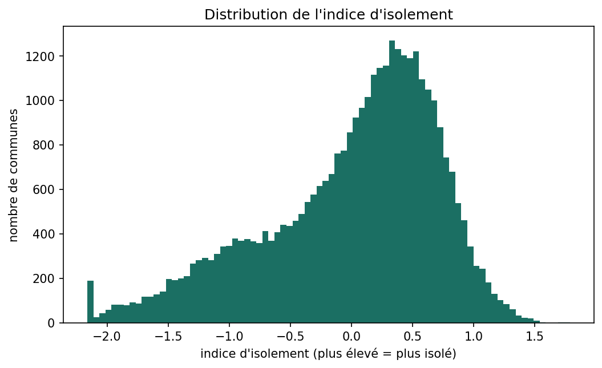
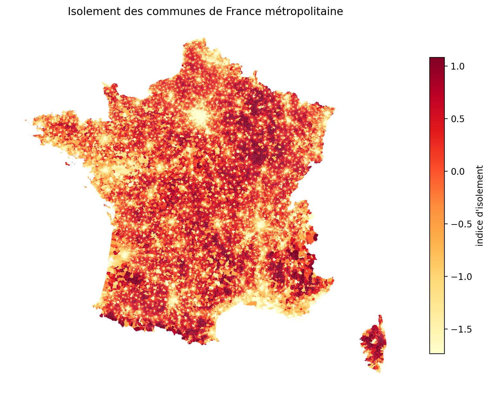
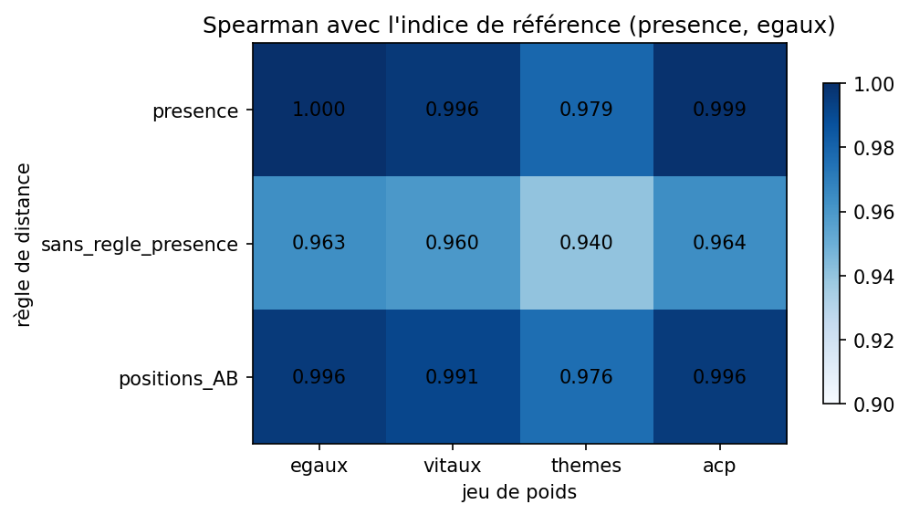

# Statistiques descriptives {#sec-descriptives}

Ce chapitre décrit nos données avant de chercher à les expliquer. Nous partons de la base des communes, puis nous regardons les distances service par service, la part de la population concernée par l'éloignement, la distribution de l'indice et les communes les plus isolées, avant de passer aux cartes et à la robustesse de l'indice. Toutes les distances sont calculées avec la règle de référence (service présent, distance 0), sauf mention contraire.

## La base des communes {#sec-base-communes}

Nous résumons d'abord les trois variables qui décrivent chaque commune : la population, la surface et la densité (@tbl-base). Nous affichons la moyenne, l'écart-type, le minimum, le maximum, la médiane et quelques centiles. Quand la moyenne est très différente de la médiane, quelques communes très grandes ou très peuplées tirent la moyenne vers le haut.

| | Moyenne | Écart-type | Min. | 10 % | 25 % | Médiane | 75 % | 90 % | Max. |
|---|--:|--:|--:|--:|--:|--:|--:|--:|--:|
| Population (habitants) | 1 902 | 8 727 | 0 | 101 | 197 | 457 | 1 167 | 3 193 | 514 819 |
| Surface (km²) | 15,8 | 17,3 | 0,0 | 4,2 | 6,5 | 11,0 | 19,0 | 31,8 | 757,1 |
| Densité (hab./km²) | 184,4 | 979,8 | 0,0 | 9,7 | 18,2 | 40,4 | 97,3 | 253,8 | 37 846,8 |

: Population, surface et densité des 34 788 communes {#tbl-base}

La population moyenne d'une commune est d'environ 1 900 habitants (66,2 millions d'habitants pour 34 788 communes), mais la médiane n'est que de 457 habitants. La France compte beaucoup de très petites communes et quelques très grandes villes, qui tirent la moyenne vers le haut : 52,5 % des communes ont moins de 500 habitants, et une commune sur dix a moins de 101 habitants. La plus peuplée dépasse 514 000 habitants. C'est pour cette raison que nous regarderons toujours les médianes et les quantiles, et pas seulement les moyennes.

La densité est encore plus étalée : la médiane est de 40 habitants par km² pour une moyenne de 184, et le maximum atteint près de 37 800 habitants par km². Une commune sur dix a moins de 10 habitants par km². Quant à l'équipement, 10 806 communes (31,1 %) n'ont aucun équipement du panier. Ce sont de petites communes, pour lesquelles les 19 distances seront toutes positives.

## Les distances par service {#sec-distances-service}

### Quels services sont présents ?

Avant de regarder les distances, nous regardons combien de communes possèdent chaque service (colonne « Communes équipées » du @tbl-distances-service). Les services du quotidien sont les plus répandus : l'école (61,0 % des communes), la poste (39,7 %) et la boulangerie (36,3 %). Les services rares sont dans très peu de communes : la maternité (1,1 %), les urgences (1,6 %), le lycée (4,3 %) et la gare (7,4 %). Aucun service n'est à 0 % ni à 100 %, ce qui montre que le panier est cohérent : chaque service existe quelque part, et aucun n'est partout.

### Quelle distance pour chaque service ?

Le @tbl-distances-service donne, pour chaque service, la part de communes équipées, la médiane, la moyenne, le 90ᵉ et le 99ᵉ centile (la distance au-delà de laquelle se trouvent les 10 % et les 1 % de communes les plus éloignées) et le maximum. Les services sont classés par distance médiane décroissante.

| Service | Communes équipées (%) | Médiane (km) | Moyenne (km) | 90ᵉ centile | 99ᵉ centile | Maximum |
|---|--:|--:|--:|--:|--:|--:|
| maternité | 1,1 | 17,99 | 19,08 | 32,81 | 46,93 | 79,08 |
| urgences | 1,6 | 14,04 | 14,75 | 25,10 | 34,75 | 53,05 |
| lycée | 4,3 | 9,66 | 10,47 | 18,91 | 27,69 | 42,12 |
| gare | 7,4 | 8,35 | 10,16 | 21,11 | 33,82 | 63,82 |
| proximité sociale | 7,2 | 7,09 | 7,73 | 14,17 | 21,63 | 42,71 |
| France Services | 7,1 | 6,28 | 6,43 | 10,79 | 15,26 | 24,64 |
| santé de proximité | 9,9 | 5,92 | 6,29 | 11,34 | 17,80 | 28,51 |
| collège | 11,1 | 5,43 | 5,66 | 10,10 | 15,67 | 35,19 |
| dentiste | 16,8 | 4,87 | 5,15 | 9,97 | 15,76 | 26,76 |
| petite enfance | 18,9 | 4,68 | 5,06 | 10,19 | 16,51 | 25,14 |
| personnes âgées | 20,0 | 4,05 | 4,05 | 7,67 | 11,80 | 35,36 |
| pharmacie | 23,3 | 3,85 | 3,79 | 7,38 | 11,07 | 18,93 |
| médecin | 25,3 | 3,66 | 3,62 | 7,26 | 10,89 | 21,05 |
| kinésithérapeute | 27,7 | 3,45 | 3,51 | 7,31 | 11,88 | 21,01 |
| alimentation | 29,8 | 3,18 | 3,13 | 6,54 | 9,93 | 17,07 |
| infirmier | 33,6 | 2,87 | 2,88 | 6,30 | 9,88 | 19,88 |
| boulangerie | 36,3 | 2,63 | 2,63 | 5,89 | 9,38 | 20,42 |
| poste | 39,7 | 2,40 | 2,25 | 5,07 | 7,50 | 13,10 |
| école | 61,0 | 0,00 | 1,38 | 4,33 | 7,06 | 15,96 |

: Distance au service le plus proche, par service {#tbl-distances-service}

Les services se rangent en trois groupes.

- Les services rares sont loin partout. La médiane est de 18,0 km pour la maternité, 14,0 km pour les urgences, 9,7 km pour le lycée et 8,4 km pour la gare. Pour la maternité, 10 % des communes sont à plus de 32,8 km, et la plus éloignée est à 79,1 km.
- Les services du quotidien sont proches de presque tout le monde : médiane de 2,4 km pour la poste, 2,6 km pour la boulangerie et 2,9 km pour l'infirmier.
- L'école est un cas à part : 61 % des communes en ont une, donc la médiane est 0, alors que la moyenne est de 1,4 km. C'est le seul service où la moyenne est nettement au-dessus de la médiane.

### La distribution des distances (hypothèse H1)

L'hypothèse H1 disait que les distances sont très asymétriques, avec une minorité de communes très éloignées. Si c'était le cas, la moyenne serait nettement plus grande que la médiane, tirée vers le haut par quelques valeurs extrêmes. Or, pour presque tous les services, la médiane et la moyenne sont très proches : 3,85 et 3,79 km pour la pharmacie, 18,0 et 19,1 km pour la maternité. La distribution des distances est donc assez resserrée, sans longue queue. Le maximum vaut entre 4 et 9 fois la médiane selon le service (4,4 fois pour la maternité), l'école mise à part : il y a bien des communes très éloignées, mais elles sont peu nombreuses. L'hypothèse H1 n'est donc pas confirmée.

La @fig-boxplot montre ces distributions sous forme de boîtes à moustaches, sur l'échelle $\ln(1+d)$, avec les services classés par médiane. La ligne centrale de chaque boîte est la médiane, la boîte va du premier au troisième quartile, et les points sont les cas qui sortent des moustaches. Pour les services rares (maternité, urgences, lycée, collège…), les points isolés à gauche correspondent aux communes qui possèdent le service : leur distance est 0, donc très loin de la boîte. Les rares points à droite (proximité sociale, France Services, santé de proximité) sont des communes particulièrement éloignées.

{#fig-boxplot fig-alt="Boîtes à moustaches des distances par service, classées par médiane décroissante, de la maternité en haut à l'école en bas" width="85%"}

## La population éloignée {#sec-population-eloignee}

Jusqu'ici, nous avons compté des communes. Or ce qui nous intéresse vraiment, ce sont les habitants. La France compte énormément de petites communes très peu peuplées : dire que beaucoup de communes sont loin d'un service donne l'impression d'un problème massif, alors qu'elles peuvent ne regrouper qu'une petite partie de la population.

Nous additionnons donc la population des communes situées à plus de 5, 10 ou 20 km d'un service, et nous la rapportons à la population totale. Le @tbl-pop-eloignee donne la part des habitants concernés. Par exemple, 53,07 % des habitants vivent dans une commune dont le centre est à plus de 5 km d'une maternité. Une commune équipée a une distance de 0 : elle n'est jamais comptée comme éloignée. Les seuils de 5, 10 et 20 km sont un choix arbitraire que l'on peut modifier.

| Service | > 5 km | > 10 km | > 20 km |
|---|--:|--:|--:|
| maternité | 53,07 | 35,80 | 13,87 |
| urgences | 48,56 | 29,48 | 7,03 |
| lycée | 32,69 | 15,21 | 1,72 |
| France Services | 29,92 | 5,68 | 0,03 |
| gare | 29,91 | 14,24 | 3,59 |
| proximité sociale | 27,46 | 9,26 | 0,50 |
| santé de proximité | 21,17 | 4,45 | 0,12 |
| collège | 15,79 | 1,87 | 0,03 |
| dentiste | 10,96 | 1,65 | 0,01 |
| petite enfance | 10,37 | 1,89 | 0,03 |
| personnes âgées | 7,60 | 0,38 | 0,01 |
| pharmacie | 5,65 | 0,19 | 0,00 |
| médecin | 5,35 | 0,21 | 0,01 |
| kinésithérapeute | 4,80 | 0,30 | 0,00 |
| alimentation | 3,78 | 0,08 | 0,00 |
| infirmier | 2,85 | 0,09 | 0,00 |
| boulangerie | 2,24 | 0,05 | 0,00 |
| poste | 1,32 | 0,01 | 0,00 |
| école | 0,46 | 0,00 | 0,00 |

: Part de la population (%) vivant dans une commune à plus de 5, 10 ou 20 km d'un service {#tbl-pop-eloignee}

Ce tableau change le regard par rapport aux distances par commune. Les services rares touchent beaucoup d'habitants : 53,1 % de la population vit à plus de 5 km d'une maternité (35,8 % à plus de 10 km et 13,9 % à plus de 20 km), 48,6 % à plus de 5 km des urgences et 32,7 % à plus de 5 km d'un lycée. À l'inverse, pour les services du quotidien, très peu d'habitants sont concernés : 0,46 % pour l'école, 1,3 % pour la poste et 2,2 % pour la boulangerie à plus de 5 km. Le seuil de 20 km distingue bien les services : seuls la maternité (13,9 %), les urgences (7,0 %), la gare (3,6 %) et le lycée (1,7 %) concernent plus de 1 % de la population à cette distance. Pour tous les autres, personne ou presque n'est à plus de 20 km.

Deux biais sont à garder en tête.

- Tous les habitants d'une commune sont supposés vivre à son centre : ils reçoivent donc la même distance au service. Dans une grande commune, certains habitants vivent près de l'équipement et d'autres bien plus loin, et l'erreur peut aller dans les deux sens selon les communes.
- Toute la population est comptée pour chaque service, alors que tous les habitants n'ont pas besoin de tous les services : les enfants pour l'école, les femmes en âge d'avoir un enfant pour la maternité, les personnes âgées pour l'hébergement. Les pourcentages mesurent donc la population exposée à l'éloignement d'un service, et pas le nombre de personnes qui en auraient réellement besoin. Avec la population par âge et par sexe de chaque commune, on pourrait affiner ce calcul dans un prolongement du projet.

## L'indice et les communes les plus isolées {#sec-indice-resultats}

### La distribution de l'indice

Nous calculons maintenant l'indice d'isolement avec la règle de référence (service présent, distance 0) et les poids égaux. Le @tbl-indices résume les quatre indices correspondant aux quatre jeux de poids. Les trois premiers ont une moyenne nulle et un écart-type proche de 0,7, qui est plus petit que 1 parce que nous faisons la moyenne de $z$ qui sont corrélés entre eux. L'indice `acp` est sur une autre échelle (écart-type de 3,1) : ce n'est pas un problème, puisque nous ne comparons que des classements.

| | Écart-type | Min. | 25 % | Médiane | 75 % | Max. |
|---|--:|--:|--:|--:|--:|--:|
| `egaux` | 0,712 | −2,160 | −0,414 | 0,161 | 0,522 | 1,786 |
| `vitaux` | 0,715 | −2,309 | −0,413 | 0,166 | 0,522 | 1,816 |
| `themes` | 0,702 | −2,086 | −0,410 | 0,129 | 0,516 | 1,706 |
| `acp` | 3,131 | −8,968 | −1,852 | 0,752 | 2,299 | 7,842 |

: Les quatre indices (moyenne nulle pour chacun) {#tbl-indices}

La première composante de l'ACP explique 51,6 % de la variance des 19 $z$. C'est beaucoup pour une seule composante : cela veut dire que les 19 distances évoluent ensemble, une commune éloignée d'un service a tendance à être éloignée des autres aussi. C'est ce qui justifie de les résumer en un seul indice.

Pour l'indice de référence (`egaux`), les quantiles sont les suivants : 1 % de communes sous −1,94, 10 % sous −1,07, la moitié sous 0,16, 90 % sous 0,78 et 99 % sous 1,19. La @fig-histogramme montre la distribution : elle n'est pas symétrique. La médiane (0,16) est au-dessus de la moyenne (0), et la queue est plus longue du côté des indices négatifs (minimum de −2,16 contre un maximum de 1,79). Autrement dit, la majorité des communes sont un peu plus isolées que la moyenne, et une minorité de communes très bien desservies, les villes, tirent la moyenne vers le bas. Le petit pic à −2,16 correspond aux communes qui ont les 19 services sur place : elles ont toutes le même indice, le minimum.

{#fig-histogramme fig-alt="Histogramme de l'indice d'isolement : distribution asymétrique, pic autour de 0,4, longue queue vers les valeurs négatives et petit pic à −2,16" width="80%"}

59,0 % des communes ont un indice supérieur à 0, c'est-à-dire qu'elles sont plus isolées que la commune moyenne. Mais elles ne regroupent que 9,9 % de la population. Les communes isolées sont donc nombreuses mais peu peuplées, alors que les 41 % de communes mieux desservies (les villes et leurs environs) regroupent 90 % des habitants.

### Les vingt communes les plus isolées

Le @tbl-top20 donne les 20 communes ou arrondissements à l'indice le plus élevé.

| Code | Commune | Population | Surface (km²) | Indice |
|---|---|--:|--:|--:|
| 64542 | Urdos | 71 | 36,7 | 1,786 |
| 2B153 | Manso | 116 | 121,3 | 1,762 |
| 64136 | Borce | 112 | 58,3 | 1,692 |
| 05064 | La Chapelle-en-Valgaudémar | 120 | 127,5 | 1,579 |
| 09100 | Couflens | 100 | 56,4 | 1,554 |
| 38375 | Saint-Christophe-en-Oisans | 99 | 237,5 | 1,536 |
| 21237 | Échalot | 93 | 27,7 | 1,536 |
| 64316 | Larrau | 179 | 127,0 | 1,529 |
| 51371 | Moivre | 54 | 22,2 | 1,527 |
| 40169 | Maillas | 125 | 63,3 | 1,515 |
| 51292 | Herpont | 121 | 23,0 | 1,505 |
| 66102 | Mantet | 35 | 32,2 | 1,504 |
| 43054 | Chanaleilles | 173 | 48,5 | 1,498 |
| 21489 | Poiseul-la-Grange | 75 | 23,1 | 1,488 |
| 2A197 | Osani | 96 | 51,7 | 1,486 |
| 51549 | Somme-Yèvre | 106 | 21,6 | 1,479 |
| 2A196 | Orto | 81 | 16,1 | 1,475 |
| 21063 | Beneuvre | 94 | 15,5 | 1,474 |
| 40161 | Lubbon | 85 | 48,2 | 1,473 |
| 51470 | Rouvroy-Ripont | 5 | 11,7 | 1,472 |

: Les 20 communes à l'indice d'isolement le plus élevé {#tbl-top20}

Ce sont de très petites communes (de 5 à 179 habitants), souvent sur de grandes surfaces. Elles se trouvent dans les Pyrénées (Urdos, Borce, Larrau, Couflens, Mantet), dans les Alpes (La Chapelle-en-Valgaudémar, Saint-Christophe-en-Oisans), en Corse (Manso, Osani, Orto), dans le Massif central (Chanaleilles), dans les Landes (Maillas, Lubbon), dans la Côte-d'Or (Échalot, Poiseul-la-Grange, Beneuvre) et dans les plaines de Champagne (Moivre, Herpont, Somme-Yèvre, Rouvroy-Ripont). C'est un profil attendu, car très peu d'habitants signifie aussi très peu d'équipements sur place. L'indice ne dit pas en revanche que ces communes sont « mal » desservies au sens de la qualité de vie : il dit qu'elles sont, relativement aux autres, loin des 19 services.

## Les cartes {#sec-cartes}

### La carte de l'indice

La @fig-carte-indice représente l'indice de chaque commune, du clair (proche des services) au foncé (isolée). L'échelle de couleurs est bornée entre les centiles 2 et 98, pour que quelques valeurs extrêmes n'écrasent pas toutes les couleurs.

{#fig-carte-indice fig-alt="Carte de la France métropolitaine colorée selon l'indice d'isolement des communes, du jaune clair au rouge foncé" width="90%"}

Les communes les plus foncées ne sont pas dispersées au hasard : elles forment de grandes zones. On voit les Alpes, les Pyrénées, la Corse, le sud-ouest (Landes), le Massif central et une large bande qui va de la Champagne à la Bourgogne. À l'inverse, les points clairs sont les grandes villes (Paris, Lyon, Bordeaux, Toulouse, Marseille…) et leurs environs, ainsi que le littoral atlantique et la Bretagne, mieux desservis. Nous n'avons pas fait de test statistique pour ce regroupement : cette lecture reste visuelle.

### Les cartes par service

L'indice résume 19 services, mais deux communes de même indice peuvent manquer de services très différents. La @fig-cartes-services montre la distance à six services : la pharmacie, le médecin, la boulangerie, l'école, les urgences et la gare. Chaque carte a sa propre échelle de couleurs, bornée au 98ᵉ centile, car les distances d'une gare et d'une boulangerie n'ont pas la même ampleur.

{#fig-cartes-services fig-alt="Six cartes de la France : pharmacie, médecin, boulangerie, école, urgences et gare, colorées selon la distance au service" width="100%"}

Les cartes ne se ressemblent pas, ce qui est cohérent avec les médianes du @tbl-distances-service. Pour la pharmacie, le médecin et la boulangerie, la plupart des communes sont proches et seules les zones de montagne (Alpes, Pyrénées, Corse) et les campagnes du centre ressortent. Pour l'école, presque tout le territoire est clair, ce qui correspond à la médiane de 0. Pour les urgences et la gare, c'est l'inverse : presque tout le territoire est foncé et seules les villes ressortent en clair. Sur la carte des gares, on voit même le réseau ferré : les zones claires s'allongent le long des lignes qui partent de Paris. C'est pour cela que l'indice a besoin des 19 services : un seul service ne suffirait pas à décrire l'isolement.

## Robustesse de l'indice {#sec-robustesse-resultats}

Nous avons présenté au chapitre 1 les 12 indices obtenus en croisant trois règles de distance et quatre jeux de poids. Nous comparons maintenant chacun d'eux à l'indice de référence avec la corrélation de Spearman (@tbl-robustesse et @fig-robustesse). Chaque case est la corrélation entre l'indice de la case et l'indice de référence (`presence` avec `egaux`, en haut à gauche, qui vaut 1).

| Règle de distance | `egaux` | `vitaux` | `themes` | `acp` |
|---|--:|--:|--:|--:|
| `presence` | 1,000 | 0,996 | 0,979 | 0,999 |
| `sans_regle_presence` | 0,963 | 0,960 | 0,940 | 0,964 |
| `positions_AB` | 0,996 | 0,991 | 0,976 | 0,996 |

: Corrélation de Spearman de chaque indice avec l'indice de référence {#tbl-robustesse}

{#fig-robustesse fig-alt="Carte de chaleur des corrélations de Spearman entre les 12 indices et l'indice de référence, de 0,940 à 1" width="70%"}

La première ligne (`presence`) ne change que le jeu de poids. `egaux` et `acp` sont presque identiques (0,999) : les poids que l'ACP trouve dans les données sont proches de poids égaux, ce qui s'accorde avec le fait qu'une seule composante explique 51,6 % de la variance. `vitaux` reste très proche (0,996) : doubler cinq services de santé et d'urgence change peu le classement. `themes` est le jeu le plus éloigné (0,979), ce qui est logique puisqu'il réduit fortement le poids de chacun des huit services de santé et augmente celui de la gare.

La colonne `egaux` ne change que la règle de distance. Ne garder que les positions de qualité A et B donne 0,996 : les coordonnées de moindre qualité ne faussent pas le classement. C'est le résultat qui nous intéresse pour la fiabilité des données, car il nous dit que le classement ne dépend pas des équipements mal localisés. La règle `sans_regle_presence` donne 0,963 : c'est le changement isolé qui modifie le plus le classement, plus que les poids. C'est cohérent, car c'est le seul qui change la définition même de la distance : une commune qui possède un service n'est plus à distance 0, mais à distance de son centre à l'équipement le plus proche.

Les cases qui combinent les deux changements restent proches elles aussi. Sur la ligne `positions_AB`, les corrélations vont de 0,976 à 0,996. Sur la ligne `sans_regle_presence`, elles vont de 0,940 à 0,964. La corrélation la plus faible avec la référence est 0,940 (`sans_regle_presence` avec `themes`), et la plus faible entre deux des 12 indices est 0,928. Toutes les valeurs sont donc supérieures à 0,9 : le classement des communes ne dépend pas beaucoup de nos choix de méthode, et l'hypothèse H4 est confirmée. Nous gardons `presence` avec `egaux` comme indice de référence, car c'est le plus simple à expliquer.
