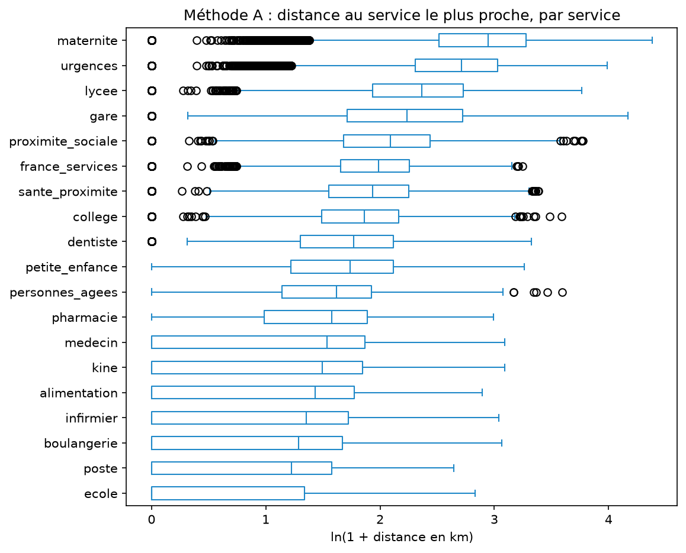
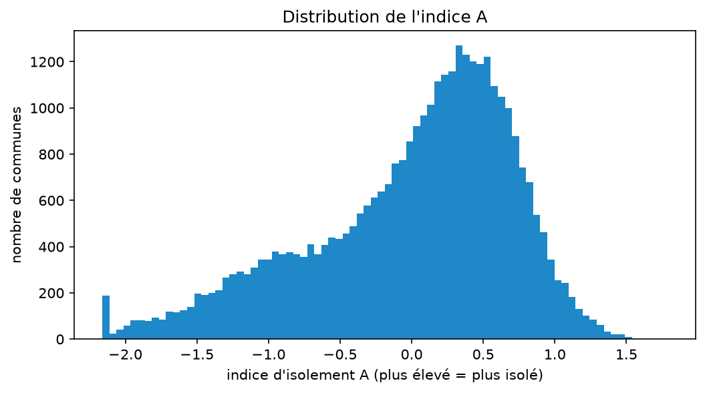
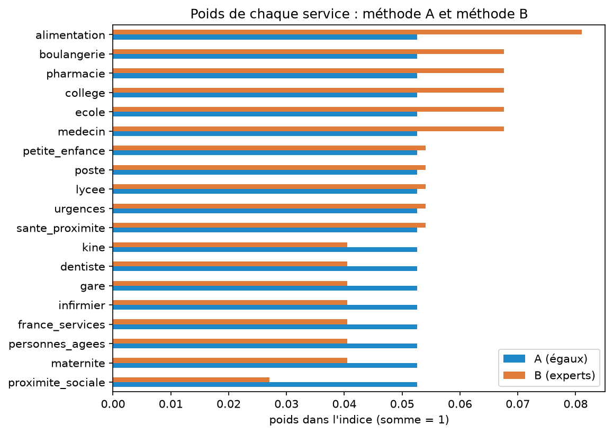
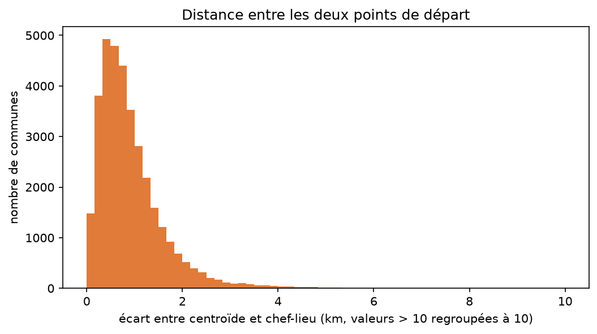
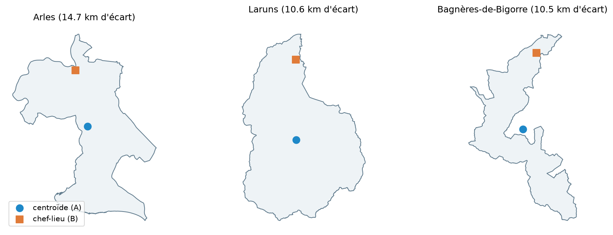
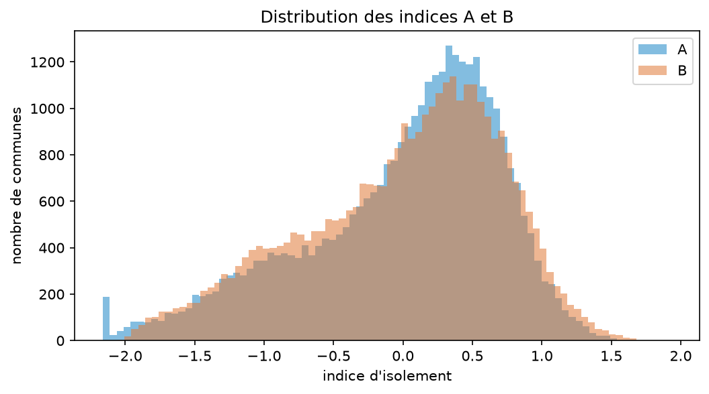
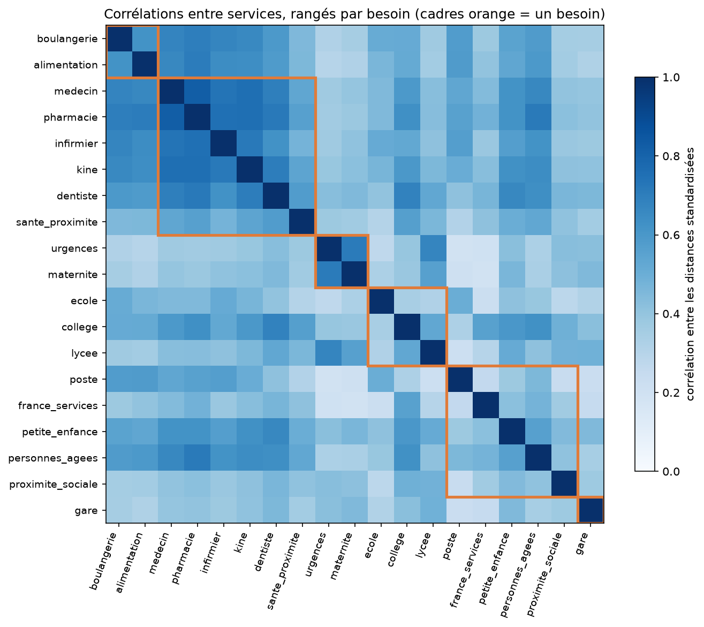
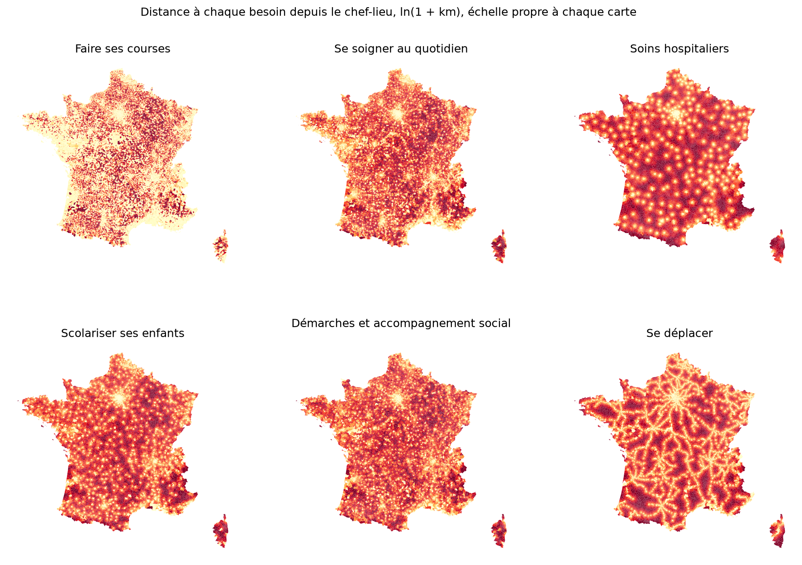
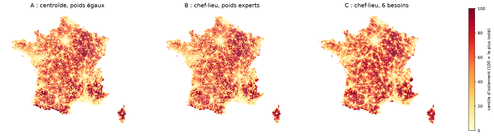
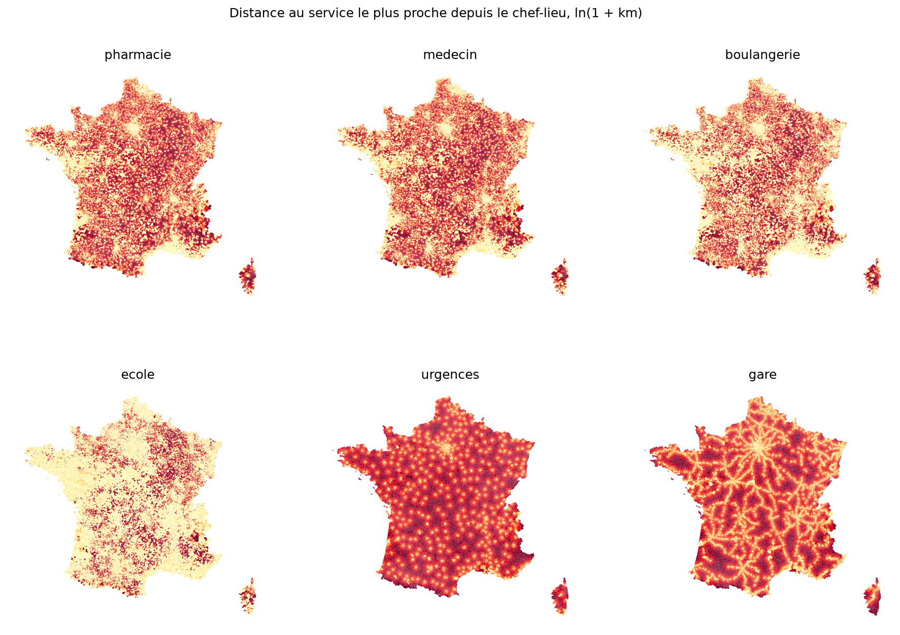

# Statistiques descriptives et indices {#sec-descriptif}

Ce chapitre décrit nos données, puis construit les trois indices un par un. Il commence par la base des communes, puis présente les distances et l'indice de la méthode A, ceux de la méthode B, enfin ceux de la méthode C. Il se termine par les cartes des trois indices. Les chiffres sont issus du notebook ; les figures sont celles qu'il enregistre.

## La base des communes {#sec-portrait}

La base compte 34 788 communes et arrondissements pour 66,2 millions d'habitants (@tbl-portrait). La commune moyenne a 1 900 habitants, mais la commune médiane n'en a que 457 : 52,5 % des communes ont moins de 500 habitants et une sur dix moins de 101, alors que la plus peuplée dépasse 514 000 habitants. La densité est encore plus étalée.

| | Moyenne | 10 % | Médiane | 90 % | Maximum |
|---|---|---|---|---|---|
| Population (habitants) | 1 902 | 101 | 457 | 3 193 | 514 819 |
| Surface (km²) | 15,8 | 4,2 | 11,0 | 31,8 | 757,1 |
| Densité (hab./km²) | 184 | 9,7 | 40 | 254 | 37 847 |

: Population, surface et densité des 34 788 communes {#tbl-portrait}

Quand la moyenne est très différente de la médiane, quelques communes très grandes ou très peuplées tirent la moyenne : nous regardons alors surtout les médianes et les quantiles.

Le panier compte 531 417 équipements, dont 99,6 % ont des coordonnées. Les positions sont de qualité `B` pour 475 609 équipements, `M` pour 30 958, `A` pour 22 686 et `_U` pour 2 164. Les services les plus nombreux sont l'infirmier (98 143 équipements), le kinésithérapeute (88 888) et le médecin (59 504) ; les plus rares sont les urgences (679) et la maternité (434).

**10 806 communes (31,1 %) n'ont aucun des 33 équipements du panier.** Pour elles, chaque service doit être cherché ailleurs, et c'est là que le choix du point de départ comptera le plus.

### Les communes équipées

Pour chaque service, nous calculons la part des communes qui possèdent au moins un équipement (@tbl-equipees).

| Service | Communes équipées (%) | Service | Communes équipées (%) |
|---|---|---|---|
| maternité | 1,1 | kinésithérapeute | 27,7 |
| urgences | 1,6 | alimentation | 29,8 |
| lycée | 4,3 | infirmier | 33,6 |
| France Services | 7,1 | boulangerie | 36,3 |
| proximité sociale | 7,2 | poste | 39,7 |
| gare | 7,4 | école | 61,0 |
| santé de proximité | 9,9 | | |
| collège | 11,1 | | |
| dentiste | 16,8 | | |
| petite enfance | 18,9 | | |
| personnes âgées | 20,0 | | |
| pharmacie | 23,3 | | |
| médecin | 25,3 | | |

: Part des communes qui possèdent le service {#tbl-equipees}

Les services du quotidien sont les plus répandus (l'école dans 61 % des communes, la poste dans 39,7 %, la boulangerie dans 36,3 %). Les services rares sont dans très peu de communes. Aucun service n'est à 0 % ni à 100 % : le panier est cohérent. Pour les services rares, presque toutes les communes vont chercher le service ailleurs, donc presque toutes sont concernées par le choix du point de départ.

## Méthode A : centroïde et poids égaux {#sec-resultats-A}

### Les distances par service

Le @tbl-distances-A donne, pour chaque service, la distribution des distances de la méthode A.

| Service | Médiane (km) | Moyenne (km) | 90ᵉ centile (km) | 99ᵉ centile (km) | Maximum (km) |
|---|---|---|---|---|---|
| maternité | 17,99 | 19,08 | 32,81 | 46,93 | 79,08 |
| urgences | 14,04 | 14,75 | 25,10 | 34,75 | 53,05 |
| lycée | 9,66 | 10,47 | 18,91 | 27,69 | 42,12 |
| gare | 8,35 | 10,16 | 21,11 | 33,82 | 63,82 |
| proximité sociale | 7,09 | 7,73 | 14,17 | 21,63 | 42,71 |
| France Services | 6,28 | 6,43 | 10,79 | 15,26 | 24,64 |
| santé de proximité | 5,92 | 6,29 | 11,34 | 17,80 | 28,51 |
| collège | 5,43 | 5,66 | 10,10 | 15,67 | 35,19 |
| dentiste | 4,87 | 5,15 | 9,97 | 15,76 | 26,76 |
| petite enfance | 4,68 | 5,06 | 10,19 | 16,51 | 25,14 |
| personnes âgées | 4,05 | 4,05 | 7,67 | 11,80 | 35,36 |
| pharmacie | 3,85 | 3,79 | 7,38 | 11,07 | 18,93 |
| médecin | 3,66 | 3,62 | 7,26 | 10,89 | 21,05 |
| kinésithérapeute | 3,45 | 3,51 | 7,31 | 11,88 | 21,01 |
| alimentation | 3,18 | 3,13 | 6,54 | 9,93 | 17,07 |
| infirmier | 2,87 | 2,88 | 6,30 | 9,88 | 19,88 |
| boulangerie | 2,63 | 2,63 | 5,89 | 9,38 | 20,42 |
| poste | 2,40 | 2,25 | 5,07 | 7,50 | 13,10 |
| école | 0,00 | 1,38 | 4,33 | 7,06 | 15,96 |

: Distance au service le plus proche, méthode A {#tbl-distances-A}

{#fig-boites-A}

Les services se rangent en trois familles (@fig-boites-A) :

- les services rares sont loin partout : médiane de 18,0 km pour la maternité, 14,0 km pour les urgences, 9,7 km pour le lycée et 8,4 km pour la gare ;
- les services intermédiaires (collège, dentiste, France Services, santé de proximité) ont une médiane de 5 à 7 km ;
- les services du quotidien sont proches : 2,4 km pour la poste, 2,6 km pour la boulangerie, 2,9 km pour l'infirmier, et 0 pour l'école, puisque 61 % des communes en ont une.

Pour chaque service, la moyenne est très proche de la médiane (3,79 et 3,85 km pour la pharmacie, 19,1 et 18,0 km pour la maternité) et le maximum vaut 4 à 9 fois la médiane. Les distances entre communes sont donc assez resserrées, sans longue queue : il n'y a pas une poignée de communes extrêmement plus éloignées que toutes les autres. Les inégalités se jouent surtout entre services.

### La population éloignée

Compter des communes donne une image trompeuse, car la France compte beaucoup de très petites communes. Nous rapportons donc la population des communes situées à plus de 5, 10 ou 20 km d'un service à la population totale (@tbl-pop-eloignee). Tous les habitants d'une commune sont supposés vivre à son point de départ, ici le centroïde.

| Service | > 5 km (%) | > 10 km (%) | > 20 km (%) |
|---|---|---|---|
| maternité | 53,07 | 35,80 | 13,87 |
| urgences | 48,56 | 29,48 | 7,03 |
| lycée | 32,69 | 15,21 | 1,72 |
| France Services | 29,92 | 5,68 | 0,03 |
| gare | 29,91 | 14,24 | 3,59 |
| proximité sociale | 27,46 | 9,26 | 0,50 |
| santé de proximité | 21,17 | 4,45 | 0,12 |
| collège | 15,79 | 1,87 | 0,03 |
| dentiste | 10,96 | 1,65 | 0,01 |
| petite enfance | 10,37 | 1,89 | 0,03 |
| personnes âgées | 7,60 | 0,38 | 0,01 |
| pharmacie | 5,65 | 0,19 | 0,00 |
| médecin | 5,35 | 0,21 | 0,01 |
| kinésithérapeute | 4,80 | 0,30 | 0,00 |
| alimentation | 3,78 | 0,08 | 0,00 |
| infirmier | 2,85 | 0,09 | 0,00 |
| boulangerie | 2,24 | 0,05 | 0,00 |
| poste | 1,32 | 0,01 | 0,00 |
| école | 0,46 | 0,00 | 0,00 |

: Part de la population à plus de 5, 10 et 20 km d'un service, méthode A {#tbl-pop-eloignee}

Raisonner en habitants change l'image. Pour les services du quotidien, très peu de personnes sont loin : 0,46 % des habitants vivent à plus de 5 km d'une école, 1,3 % d'une poste, 2,2 % d'une boulangerie, environ 5,5 % d'un médecin ou d'une pharmacie. À l'inverse, 53,1 % des habitants vivent à plus de 5 km d'une maternité (35,8 % à plus de 10 km, 13,9 % à plus de 20 km) et 48,6 % à plus de 5 km des urgences. Ces pourcentages comptent toute la population pour chaque service : ils mesurent l'exposition à l'éloignement, pas le nombre de personnes qui ont réellement besoin du service. Seules les femmes enceintes vont à la maternité, par exemple.

### L'indice A

L'indice A a une moyenne nulle par construction et un écart-type de 0,71 (@tbl-indices). Sa distribution est asymétrique vers la gauche : la médiane (0,16) est au-dessus de la moyenne, et la queue la plus longue est du côté des communes très bien desservies (minimum −2,16, maximum 1,79). La majorité des communes sont un peu plus isolées que la moyenne, et une minorité de villes très bien équipées tire la moyenne vers le bas.

{#fig-histo-A}

59 % des communes ont un indice positif, mais elles ne regroupent que 9,9 % de la population : les communes isolées sont nombreuses mais peu peuplées. Les communes les plus isolées sont de très petits villages (35 à 179 habitants) des Pyrénées (Urdos, Borce, Larrau, Couflens, Mantet), des Alpes (La Chapelle-en-Valgaudémar, Saint-Christophe-en-Oisans) et de Corse (Manso, Osani), mais aussi des plateaux de Bourgogne (Échalot, Poiseul-la-Grange) et de Champagne (Moivre, Herpont).

## Méthode B : chef-lieu, distance réelle et poids experts {#sec-resultats-B}

### La grille de pondération

Le @tbl-grille donne la note de chaque service sur les trois critères, le score $1 + E + F + P$, le poids qui en résulte et la justification retenue.

| Service | E | F | P | Score | Poids | Justification |
|---|---|---|---|---|---|---|
| alimentation | 2 | 2 | 1 | 6 | 0,0811 | se nourrir, plusieurs fois par semaine, pour tous |
| boulangerie | 1 | 2 | 1 | 5 | 0,0676 | commerce le plus fréquenté, en partie substituable |
| pharmacie | 2 | 1 | 1 | 5 | 0,0676 | seul accès aux médicaments, recours régulier |
| médecin | 2 | 1 | 1 | 5 | 0,0676 | porte d'entrée du soin (médecin traitant), pour tous |
| école | 2 | 2 | 0 | 5 | 0,0676 | obligatoire dès 3 ans, trajet quotidien, familles |
| collège | 2 | 2 | 0 | 5 | 0,0676 | obligatoire, trajet quotidien, 11-15 ans |
| poste | 1 | 1 | 1 | 4 | 0,0541 | courrier, colis, services bancaires de base |
| petite enfance | 1 | 2 | 0 | 4 | 0,0541 | garde d'enfant, condition de l'emploi des parents |
| santé de proximité | 1 | 1 | 1 | 4 | 0,0541 | centre ou maison de santé : soins de premier recours |
| urgences | 2 | 0 | 1 | 4 | 0,0541 | vital (AVC, infarctus) mais recours rare |
| lycée | 1 | 2 | 0 | 4 | 0,0541 | formation jusqu'à 18 ans, trajet quotidien, 15-18 ans |
| personnes âgées | 1 | 1 | 0 | 3 | 0,0405 | prise en charge des personnes âgées dépendantes |
| France Services | 1 | 0 | 1 | 3 | 0,0405 | démarches administratives, occasionnelles |
| maternité | 2 | 0 | 0 | 3 | 0,0405 | vital à l'accouchement, rare, public particulier |
| infirmier | 1 | 1 | 0 | 3 | 0,0405 | soins réguliers des malades chroniques et des âgés |
| kinésithérapeute | 1 | 1 | 0 | 3 | 0,0405 | rééducation, recours régulier mais ciblé |
| dentiste | 1 | 0 | 1 | 3 | 0,0405 | soins courants, une à deux fois par an |
| gare | 0 | 1 | 1 | 3 | 0,0405 | alternative à la voiture, non vitale |
| proximité sociale | 0 | 1 | 0 | 2 | 0,0270 | lien social, accompagnement ; public ciblé |

: Grille de pondération de la méthode B {#tbl-grille}

La grille donne le poids le plus fort à l'alimentation (score 6 : vitale, quotidienne, pour tous), puis aux services vitaux ou quotidiens (boulangerie, pharmacie, médecin, école, collège : score 5). Les services les moins pondérés sont la proximité sociale (score 2) et, au score 3, la gare, le dentiste, la maternité, l'infirmier, le kinésithérapeute, France Services et l'aide aux personnes âgées. Le poids le plus fort (8,1 %) est trois fois le plus faible (2,7 %), alors qu'en A tous les services valent 5,3 %.

{#fig-poids}

Au niveau des thèmes, les écarts sont plus faibles qu'on pourrait le penser (@tbl-poids-themes). Les poids experts redistribuent surtout à l'intérieur des thèmes (le médecin pèse plus que le kinésithérapeute) plutôt qu'entre eux. On peut donc s'attendre à ce que ce changement modifie peu le classement des communes.

| | Commerces | Enseignement | Santé | Services publics | Transport |
|---|---|---|---|---|---|
| A (poids égaux) | 0,105 | 0,158 | 0,421 | 0,263 | 0,053 |
| B (poids experts) | 0,149 | 0,189 | 0,405 | 0,216 | 0,041 |

: Poids de chaque thème dans les méthodes A et B {#tbl-poids-themes}

### Le point de départ : centroïde ou chef-lieu

La fonction `lire_chefs_lieux` lit les deux couches ponctuelles de l'IGN, et `centres_chef_lieu` remplace le centroïde de chaque commune par son chef-lieu. Elles calculent aussi l'écart entre les deux points, en km.

Le chef-lieu est trouvé pour toutes les communes sauf 6, toutes dans la Meuse (codes 55039, 55050, 55139, 55189, 55239 et 55307) : ce sont des villages détruits pendant la bataille de Verdun et jamais reconstruits, sans habitant. Nous gardons leur centroïde.

Dans la plupart des communes, les deux points sont proches : l'écart médian est de 750 m, et 90 % des communes ont un écart inférieur à 1,8 km (@tbl-ecart). Mais 7 % des communes ont un écart supérieur à 2 km, et 125 communes (0,4 %) un écart supérieur à 5 km. L'écart augmente avec la surface (corrélation de Spearman de 0,48).

| Moyenne | 25 % | Médiane | 75 % | 90 % | 99 % | Maximum |
|---|---|---|---|---|---|---|
| 0,93 | 0,45 | 0,75 | 1,19 | 1,76 | 3,73 | 14,7 |

: Écart entre le centroïde et le chef-lieu (km) {#tbl-ecart}

{#fig-ecart}

Trois communes de plus de 1 000 habitants où l'écart est le plus grand montrent les cas typiques (@fig-exemples-centres).

{#fig-exemples-centres}

À Arles, la plus grande commune de France métropolitaine (757 km², dont une grande partie de la Camargue), le centroïde tombe au milieu des marais, à 14,7 km de la ville. À Laruns et à Bagnères-de-Bigorre, communes de montagne, le centroïde est en haute vallée ou sur les sommets, alors que le bourg est en bas. Dans ces communes, mesurer depuis le centroïde revient à mesurer l'éloignement d'un endroit où personne n'habite.

### Les distances de la méthode B

Nous relançons le calcul avec les chefs-lieux comme points de départ et sans la règle de présence (`regle_presence=False`). Toutes les communes sont concernées : celles qui n'ont pas le service (le point de départ change) et celles qui l'ont (la distance n'est plus 0, mais la distance réelle entre le chef-lieu et l'équipement).

**Les communes qui ont le service.** Le @tbl-interne répond à la question que l'indicatrice de A masquait : à quelle distance du chef-lieu se trouve réellement l'équipement de la commune ?

| Service | Communes équipées | Médiane (km) | 90ᵉ centile (km) | Part à plus de 1 km (%) |
|---|---|---|---|---|
| maternité | 381 | 1,20 | 2,69 | 61,4 |
| urgences | 568 | 1,06 | 2,37 | 52,8 |
| gare | 2 563 | 0,64 | 1,62 | 25,1 |
| lycée | 1 480 | 0,57 | 1,56 | 25,5 |
| collège | 3 874 | 0,46 | 1,09 | 12,3 |
| proximité sociale | 2 506 | 0,34 | 1,32 | 17,9 |
| santé de proximité | 3 436 | 0,31 | 1,06 | 11,0 |
| petite enfance | 6 584 | 0,31 | 1,04 | 10,7 |
| dentiste | 5 840 | 0,23 | 0,76 | 5,9 |
| personnes âgées | 6 953 | 0,23 | 0,84 | 7,6 |
| kinésithérapeute | 9 639 | 0,22 | 0,80 | 7,3 |
| médecin | 8 791 | 0,21 | 0,70 | 5,3 |
| France Services | 2 476 | 0,21 | 1,27 | 14,0 |
| pharmacie | 8 090 | 0,18 | 0,69 | 5,2 |
| infirmier | 11 684 | 0,17 | 0,64 | 5,2 |
| alimentation | 10 368 | 0,17 | 0,96 | 9,4 |
| boulangerie | 12 614 | 0,14 | 0,88 | 9,1 |
| école | 21 219 | 0,12 | 0,40 | 1,9 |
| poste | 13 813 | 0,08 | 0,36 | 1,7 |

: Distance entre le chef-lieu et l'équipement le plus proche, dans les communes qui ont le service {#tbl-interne}

Pour les services du quotidien, l'équipement de la commune est en général tout près du chef-lieu : distance médiane de 80 m pour la poste, 120 m pour l'école, 140 m pour la boulangerie, 180 m pour la pharmacie. Moins de 10 % des communes équipées ont leur boulangerie ou leur épicerie à plus de 1 km du chef-lieu. Mettre ces distances à 0, comme le fait A, est donc une bonne approximation pour les services de proximité.

Ce n'est plus vrai pour les grands équipements. Dans les communes qui ont une maternité ou des urgences, l'hôpital est à 1,1 à 1,2 km du chef-lieu (distance médiane), et à plus de 1 km dans plus de la moitié des cas. Les hôpitaux, les gares et les lycées sont souvent en périphérie de la ville. La méthode B en tient compte, la méthode A non.

**L'ensemble des communes.** Les distances médianes changent peu entre A et B : elles baissent un peu pour les services qui manquent à la plupart des communes (de −0,02 km pour la maternité à −0,3 km pour la poste), car le chef-lieu, au cœur du bourg, est en général mieux placé que le centroïde par rapport aux bourgs voisins équipés. La seule exception est l'école, dont la médiane passe de 0 à 0,29 km : 61 % des communes en ont une, et sa distance n'est plus mise à 0. La part de la population à plus de 10 km d'un service baisse légèrement (de 35,8 % à 35,5 % pour la maternité, de 29,5 % à 29,2 % pour les urgences, de 15,2 % à 14,9 % pour le lycée).

Pour les services rares, déplacer le point de départ de 1 km change peu une distance de 18 km. C'est pour les services du quotidien, à 2 ou 3 km, que le choix du point de départ pèse le plus.

### L'indice B

Le @tbl-indices compare la distribution des indices A, B et C. Les deux premiers ont des distributions proches (écart-type de 0,72 pour B et 0,71 pour A). B est un peu plus étalé vers le haut : son maximum est de 1,93, contre 1,79 pour A. 56,6 % des communes ont un indice B positif, pour 9,4 % de la population (59,0 % et 9,9 % avec A).

{#fig-histo-AB}

Le haut du classement se recompose. Manso (Corse) prend la première place. Les villages de montagne restent présents (La Chapelle-en-Valgaudémar, Urdos, Osani), mais plusieurs autres reculent : Borce, Couflens, Larrau et Saint-Christophe-en-Oisans sortent des quinze premiers. Les villages de plateau du Nord-Est gagnent des places : Champagne (Moivre, Herpont, Le Fresne, Minaucourt), Bourgogne (Échalot, Poiseul-la-Grange), Yonne (Arthonnay), Haute-Marne (Germay). Dans ces villages, le bourg est petit et loin de tout ; centroïde et chef-lieu y sont proches, si bien que le changement de point de départ ne les avantage pas. En montagne au contraire, le chef-lieu en fond de vallée les rapproche des services.

### Une lecture en kilomètres

Un indice standardisé est commode pour classer, mais il ne parle pas : que veut dire « 0,8 » ? Nous calculons donc aussi, avec les poids de B, la distance moyenne pondérée aux 19 services, en kilomètres :

$$D_c^{B} = \sum_{s=1}^{19} w_s^{B} \, d^{B}_{c,s}$$ {#eq-km}

et, pour comparaison, $D_c^{A} = \frac{1}{19}\sum_s d^{A}_{c,s}$ avec les poids égaux. Le terme $w_s \, d_{c,s}$ dit combien de kilomètres l'absence du service $s$ ajoute à $D_c$. Cette distance n'est pas standardisée : les services rares, toujours lointains, y pèsent lourd, ce qui la rend plus sensible qu'un indice aux quelques services très éloignés.

| | A (poids égaux) | B (poids experts) |
|---|---|---|
| Moyenne | 6,21 | 5,75 |
| Écart-type | 2,79 | 2,59 |
| Minimum | 0,00 | 0,19 |
| Médiane | 6,18 | 5,69 |
| 90ᵉ centile | 9,77 | 9,09 |
| 99ᵉ centile | 13,20 | 12,34 |
| Maximum | 21,90 | 17,89 |

: Distance moyenne pondérée aux 19 services (km) {#tbl-km}

Avec la méthode B, la commune médiane est à 5,7 km en moyenne pondérée de ses services, une commune sur dix à plus de 9,1 km, et la plus isolée (Manso) à 17,9 km. Aucune commune n'est à 0 km : même une grande ville a ses services à quelques centaines de mètres de son chef-lieu (le minimum est de 0,19 km).

Rapporté aux habitants, l'ordre de grandeur est plus faible : l'habitant moyen est à 2,2 km (2,24 km avec B, 2,25 km avec A). Les deux méthodes donnent presque le même chiffre, pour deux raisons qui se compensent. B mesure une distance réelle dans les villes, là où A met 0, ce qui augmente la distance. Mais B part du bourg plutôt que du centroïde dans les communes non équipées, ce qui la diminue.

Cette distance en km classe les communes presque comme l'indice B (Spearman de 0,94). L'écart vient de la standardisation : en km, les services rares (maternité, urgences) pèsent beaucoup plus, puisque leurs distances sont les plus grandes. Nous gardons l'indice standardisé pour classer, et le kilomètre pour donner un ordre de grandeur.

## Méthode C : six grands besoins {#sec-resultats-C}

### Le poids de chaque besoin

Le regroupement en besoins change la part de chaque domaine dans l'indice (@tbl-poids-besoins).

| Besoin | Services | Poids dans A (%) | Poids dans B (%) | Poids dans C (%) |
|---|---|---|---|---|
| Faire ses courses | 2 | 10,5 | 14,9 | 16,7 |
| Se soigner au quotidien | 6 | 31,6 | 31,1 | 16,7 |
| Soins hospitaliers | 2 | 10,5 | 9,5 | 16,7 |
| Scolariser ses enfants | 3 | 15,8 | 18,9 | 16,7 |
| Démarches et accompagnement social | 5 | 26,3 | 21,6 | 16,7 |
| Se déplacer | 1 | 5,3 | 4,1 | 16,7 |

: Poids de chaque besoin dans les trois indices {#tbl-poids-besoins}

Dans A et B, se soigner au quotidien pesait près d'un tiers de l'indice (31,6 % et 31,1 %) parce qu'il réunit 6 services, et les démarches et l'accompagnement social plus d'un cinquième (26,3 % et 21,6 %). À l'inverse, la gare ne pesait que 5,3 % (A) et 4,1 % (B), et l'hôpital environ 10 %. Dans C, chaque besoin pèse 16,7 %. Le transport voit donc son poids multiplié par 3 à 4, l'hôpital par 1,6 à 1,8, tandis que les soins courants sont divisés par deux. C est la méthode qui donne le plus de place aux équipements rares (gare, hôpital). C'est un choix assumé : chaque grand besoin de la vie courante compte autant, quel que soit le nombre de types d'équipements que la BPE utilise pour le décrire.

### Les groupes ont-ils du sens ?

Un regroupement n'a de sens statistique que si les services d'un même besoin varient ensemble : une commune loin du médecin devrait aussi être plutôt loin de l'infirmier. Nous le vérifions avec la matrice des corrélations entre les 19 distances standardisées de la méthode B, rangées besoin par besoin (@fig-correlations). Si les groupes sont cohérents, on doit voir des carrés plus foncés sur la diagonale que dans le reste de la matrice.

{#fig-correlations}

Le @tbl-coherence résume, pour chaque besoin, la corrélation moyenne entre ses propres services et la corrélation moyenne avec les services des autres besoins. Un groupe est cohérent quand la première dépasse nettement la seconde.

| Besoin | Services | Corrélation interne | Corrélation avec les autres | Écart |
|---|---|---|---|---|
| Faire ses courses | 2 | 0,62 | 0,50 | 0,12 |
| Se soigner au quotidien | 6 | 0,66 | 0,50 | 0,17 |
| Soins hospitaliers | 2 | 0,71 | 0,37 | 0,34 |
| Scolariser ses enfants | 3 | 0,40 | 0,45 | −0,06 |
| Démarches et accompagnement social | 5 | 0,40 | 0,45 | −0,05 |
| Se déplacer | 1 | | 0,38 | |

: Cohérence statistique des six besoins {#tbl-coherence}

Trois groupes sur cinq sont cohérents, deux ne le sont pas. Le transport, avec un seul service, ne se teste pas.

- Les soins hospitaliers forment le groupe le plus net : urgences et maternité ont une corrélation de 0,71 entre elles, contre 0,37 avec le reste. Ce sont les mêmes hôpitaux.
- Se soigner au quotidien : 0,66 en interne contre 0,50 avec les autres. Le carré médecin, pharmacie, infirmier, kinésithérapeute est le plus foncé de la matrice : ces professionnels s'installent dans les mêmes bourgs.
- Faire ses courses : 0,62 contre 0,50. La boulangerie et la supérette vont ensemble.
- Scolariser ses enfants et démarches et accompagnement social : la corrélation interne (0,40) est plus faible que la corrélation avec les autres groupes (0,45). Leurs services sont de rareté très différente. L'école est présente dans 61 % des communes, le lycée dans 4 % ; la poste dans 40 %, France Services dans 7 %. Sur la matrice, le lycée ressemble davantage aux urgences qu'à l'école, et la poste davantage à la boulangerie qu'à France Services.

Les distances aux services s'organisent donc d'abord selon leur rareté (proximité ou équipement rare) et seulement ensuite selon leur thème. Nos groupes sont construits par thème, pas par rareté. Les deux groupes qui ne sont pas cohérents restent défendables comme besoins (scolariser un enfant de 3 à 18 ans demande d'accéder à l'école, puis au collège, puis au lycée), mais leur distance moyenne mélange un équipement proche et un équipement lointain.

### Les distances aux six besoins

Le @tbl-dist-besoins décrit chaque besoin : distance médiane et extrêmes, part de la population éloignée.

| Besoin | Médiane (km) | Moyenne (km) | 90ᵉ centile (km) | 99ᵉ centile (km) | Maximum (km) | Population à plus de 10 km (%) |
|---|---|---|---|---|---|---|
| Soins hospitaliers | 16,50 | 16,85 | 27,52 | 36,61 | 59,77 | 34,13 |
| Se déplacer | 8,26 | 10,11 | 21,09 | 33,56 | 67,31 | 14,08 |
| Scolariser ses enfants | 5,56 | 5,80 | 9,82 | 14,34 | 24,54 | 1,13 |
| Démarches et accompagnement social | 5,00 | 5,04 | 8,05 | 11,09 | 18,42 | 0,22 |
| Se soigner au quotidien | 4,05 | 4,15 | 7,38 | 10,93 | 17,78 | 0,12 |
| Faire ses courses | 1,95 | 2,21 | 5,10 | 7,90 | 13,18 | 0,01 |

: Distance aux six besoins depuis le chef-lieu {#tbl-dist-besoins}

Les six besoins se rangent nettement :

- les soins hospitaliers sont de loin le besoin le plus éloigné : médiane de 16,5 km, et 34 % des habitants à plus de 10 km ;
- le transport vient ensuite : médiane de 8,3 km, 14 % des habitants à plus de 10 km d'une gare ;
- la scolarité (5,6 km), les démarches (5,0 km) et les soins courants (4,1 km) sont intermédiaires, avec très peu d'habitants au-delà de 10 km (de 0,1 à 1,1 %) ;
- les courses sont le besoin le plus proche : 2,0 km en médiane grâce à la règle du minimum, et pratiquement personne à plus de 10 km.

{#fig-cartes-besoins}

Les cartes (@fig-cartes-besoins) montrent que chaque besoin a sa propre géographie. Le transport dessine en clair le réseau ferré en étoile autour de Paris. Les soins hospitaliers forment des taches claires autour de chaque ville hospitalière. Les courses et les soins courants donnent une image en mosaïque très fine, où seuls les espaces les plus vides ressortent (diagonale du Nord-Est, Massif central, montagnes).

### L'indice C

Le @tbl-indices rassemble les trois indices.

| | Indice A | Indice B | Indice C |
|---|---|---|---|
| Écart-type | 0,712 | 0,716 | 0,790 |
| Minimum | −2,160 | −2,057 | −2,798 |
| 1 % | −1,941 | −1,756 | −2,259 |
| 10 % | −1,073 | −1,066 | −1,100 |
| 25 % | −0,414 | −0,479 | −0,455 |
| Médiane | 0,161 | 0,129 | 0,127 |
| 75 % | 0,522 | 0,536 | 0,571 |
| 90 % | 0,778 | 0,832 | 0,899 |
| 99 % | 1,186 | 1,283 | 1,413 |
| Maximum | 1,786 | 1,931 | 2,024 |

: Distribution des trois indices (moyenne nulle par construction) {#tbl-indices}

L'indice C a une dispersion un peu plus forte que A et B (écart-type de 0,79 contre 0,71 et 0,72). En moyennant 6 besoins au lieu de 19 services, on compense moins les écarts : une commune loin de la gare et de l'hôpital n'est plus « rattrapée » par la proximité de six professionnels de santé. 56,4 % des communes ont un indice positif, pour 10,4 % de la population, des chiffres proches de A et B. Concrètement, la commune médiane est à 7,2 km en moyenne de ses six besoins, et l'habitant moyen à 3,1 km.

Le haut du classement reste dominé par les mêmes territoires : la Corse (Manso, Osani), les Pyrénées (Urdos, Larrau), les plateaux de Bourgogne (Échalot, Moitron, Minot, Saint-Broing-les-Moines, Chaugey, Poiseul-la-Grange). On y voit aussi apparaître Losse et Lubbon (Landes) et Saint-Maurice-Navacelles (Hérault).

**De quoi les communes les plus isolées sont-elles le plus éloignées ?** Pour chaque commune, le besoin le plus éloigné est celui où son $z$ est le plus élevé, c'est-à-dire celui où elle est la plus en retard par rapport aux autres communes (@tbl-besoin-max).

| Besoin le plus éloigné | Toutes les communes (%) | 10 % les plus isolées (%) |
|---|---|---|
| Faire ses courses | 29,9 | 31,1 |
| Scolariser ses enfants | 11,3 | 20,8 |
| Se déplacer | 22,2 | 17,1 |
| Se soigner au quotidien | 10,0 | 13,9 |
| Démarches et accompagnement social | 11,2 | 12,2 |
| Soins hospitaliers | 15,4 | 4,8 |

: Besoin où la commune est la plus en retard (méthode C) {#tbl-besoin-max}

Parmi les 10 % de communes les plus isolées selon C, le besoin où le retard est le plus grand est d'abord les courses (31 %), puis la scolarité (21 %) et le transport (17 %). L'hôpital n'est le besoin le plus en retard que pour 5 % d'entre elles, contre 15 % de l'ensemble des communes. Le $z$ mesure un retard relatif aux autres communes : tout le monde est loin de l'hôpital, donc en être loin distingue peu. Ce qui distingue vraiment les communes les plus isolées, c'est de ne pas avoir de commerce ni d'école à proximité.

## Les cartes des trois indices {#sec-cartes}

Les trois indices n'ont pas la même échelle. Pour comparer les cartes, nous colorons chaque commune selon son centile : 90 veut dire que la commune est plus isolée que 90 % des communes, selon la méthode considérée.

{#fig-cartes-ABC}

Les trois cartes (@fig-cartes-ABC) dessinent les mêmes grandes zones d'isolement :

- la « diagonale » peu dense qui va des Ardennes et de la Champagne à la Bourgogne, puis au Massif central ;
- les massifs montagneux : Pyrénées, Alpes du Sud, Corse ;
- l'intérieur des Landes et du Sud-Ouest.

Les grandes agglomérations, la Bretagne, le littoral atlantique et la vallée du Rhône sont mieux desservis.

A et B sont presque indiscernables à cette échelle. Leur différence porte sur des communes isolées les unes des autres, surtout en montagne (chapitre [5](#sec-comparaison)). C se distingue nettement : les zones isolées y sont plus larges et plus lisses, et de longs couloirs clairs les traversent, en étoile depuis Paris. Ce sont les lignes de chemin de fer. Le transport et l'hôpital pèsent chacun un sixième dans C, si bien que la proximité d'une gare et d'une ville hospitalière structure la carte.

### Quel service manque, et où ?

L'indice résume 19 services, mais deux communes de même indice peuvent manquer de services différents. La @fig-cartes-services cartographie la distance à six services (méthode B, $\ln(1 + d)$), chacun avec sa propre échelle de couleurs, bornée au 98ᵉ centile.

{#fig-cartes-services}

Les cartes par service ne se ressemblent pas. Pour la pharmacie, le médecin et la boulangerie, la plupart des communes sont proches, et seules la montagne et la diagonale peu dense ressortent. Pour l'école, presque tout le territoire est clair. Pour les urgences et la gare, c'est l'inverse : presque tout le territoire est foncé, seules les villes ressortent, et la carte des gares dessine même le réseau ferré. C'est pour cette raison qu'un indice a besoin de plusieurs services : un seul ne décrit pas l'isolement.
