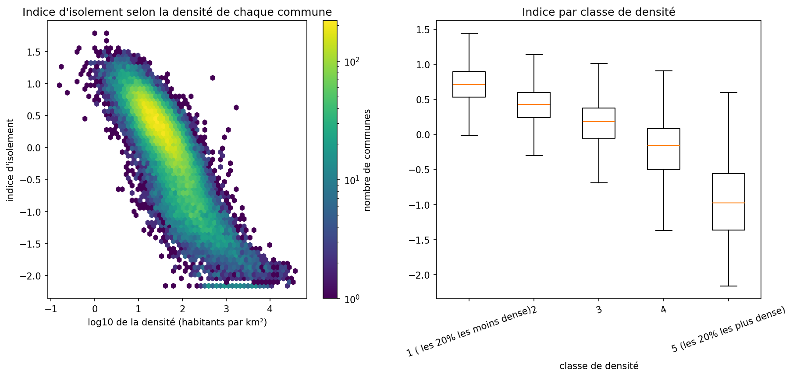
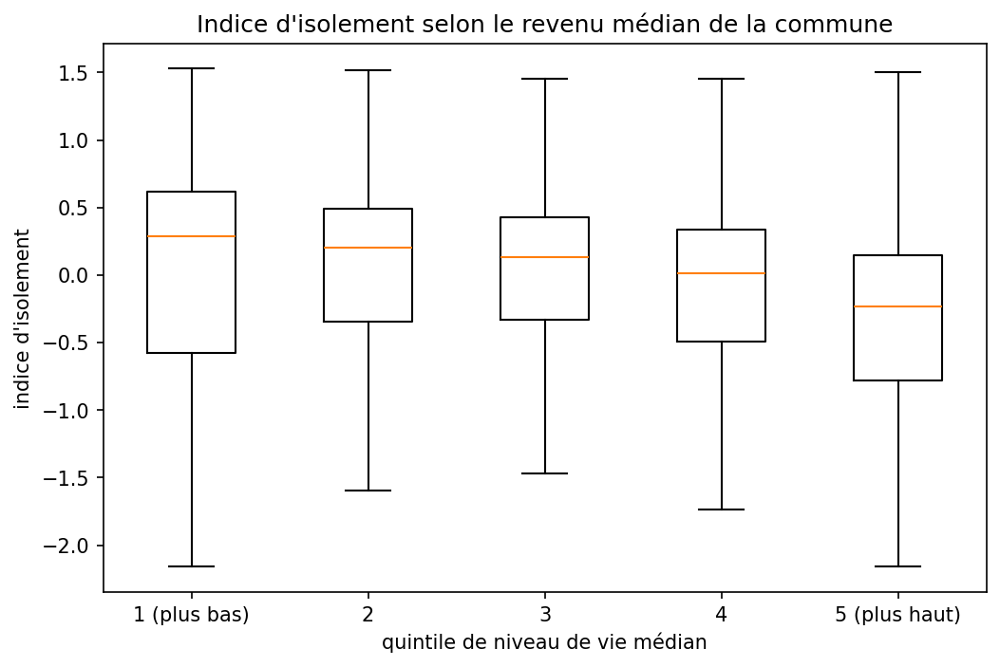

# Facteurs de l'isolement {#sec-facteurs}

Le chapitre précédent décrit l'isolement. Nous cherchons maintenant à savoir avec quoi il va de pair. Nous examinons deux caractéristiques des communes, la densité de population (hypothèse H2) et le niveau de vie (hypothèse H3), puis nous vérifions que ces résultats ne dépendent pas de la méthode de calcul de l'indice. Dans tout le chapitre, l'indice est celui de référence (règle de présence, poids égaux).

Nous utilisons la corrélation de Spearman et non celle de Pearson. Pearson mesure une relation en ligne droite entre les valeurs : comme la densité est très asymétrique, quelques communes très denses dominent le calcul. Spearman remplace chaque valeur par son rang puis calcule la corrélation des rangs. Elle ne dépend ni de l'échelle ni des valeurs extrêmes, et détecte toute relation qui va toujours dans le même sens. Elle vaut −1 (sens opposés), 0 (aucun lien) ou +1 (même ordre). Avec 34 000 communes, la p-value est minuscule pour presque n'importe quel lien : c'est donc la valeur de ρ qui compte, pas la p-value. Nous la complétons par le test de Kruskal-Wallis entre classes et sa taille d'effet $\varepsilon^2$ (voir la section [Outils statistiques](01-donnees-methodologie.qmd#sec-outils)).

## Densité de population {#sec-densite}

L'hypothèse H2 dit que plus une commune est peu dense, plus elle est isolée. Le lien est très net : le ρ de Spearman entre l'indice et la densité vaut −0,843 sur 34 788 communes. Nous répartissons ensuite les communes en cinq classes de densité de même effectif (les quintiles) et nous comparons l'indice entre les classes (@tbl-densite). Le test de Kruskal-Wallis donne $H = 23\,639$ et une taille d'effet $\varepsilon^2 = 0{,}68$, ce qui est très fort : la densité seule explique à peu près les deux tiers de la variation des rangs de l'indice.

| Classe de densité | Communes | Indice médian | 1ᵉʳ quartile | 3ᵉ quartile |
|---|--:|--:|--:|--:|
| 1 (20 % les moins denses) | 6 958 | 0,718 | 0,532 | 0,897 |
| 2 | 6 957 | 0,431 | 0,241 | 0,602 |
| 3 | 6 958 | 0,187 | −0,052 | 0,375 |
| 4 | 6 957 | −0,156 | −0,497 | 0,085 |
| 5 (20 % les plus denses) | 6 958 | −0,978 | −1,364 | −0,561 |

: Indice d'isolement selon la classe de densité {#tbl-densite}

L'indice médian passe de 0,72 pour les 20 % de communes les moins denses à −0,98 pour les 20 % les plus denses. La baisse est régulière sur les cinq classes, et c'est entre les deux dernières qu'elle est la plus forte. La @fig-densite illustre ce lien.

{#fig-densite fig-alt="Trois graphiques liant l'indice d'isolement à la densité de population" width="100%"}

Ce résultat est logique : un service s'installe là où il y a assez d'habitants pour le faire vivre, donc les communes peu denses en ont moins sur place et doivent aller les chercher plus loin. Le lien reste une corrélation : il décrit ce que nous observons, il ne prouve pas que la faible densité est la cause de l'isolement. L'hypothèse H2 est confirmée.

## Niveau de vie {#sec-revenu}

### Le revenu médian

Nous utilisons le niveau de vie médian de chaque commune (indicateur `MED_SL` de Filosofi 2023). Il est disponible pour 30 812 communes sur 34 788. La médiane des niveaux de vie communaux est de 25 780 € (moyenne 26 270 €, écart-type 3 541 €). La plupart des communes se situent entre 24 090 € et 27 840 € (premier et troisième quartiles), et quelques communes très aisées tirent le maximum à 62 730 €. Les 3 976 communes sans revenu publié (11,4 %) le sont à cause du secret statistique : pour une très petite commune, publier la valeur permettrait de deviner les revenus des habitants.

### Les communes sans revenu sont-elles différentes ?

Ces communes ne sont pas un échantillon aléatoire. Leur indice médian est de 0,72, contre 0,07 pour les communes avec revenu (Kruskal-Wallis, p < 0,001, $\varepsilon^2 = 0{,}16$, effet fort). Elles ne regroupent en revanche que 0,44 % de la population. L'analyse du revenu porte donc sur un échantillon moins isolé que l'ensemble des communes, et ses conclusions ne s'appliquent pas aux communes les plus isolées.

### Le lien entre isolement et revenu

Sur les 30 812 communes qui ont un revenu, le ρ de Spearman entre l'indice et le revenu vaut −0,216. Nous répartissons ces communes en cinq quintiles de revenu (@tbl-revenu). Le test de Kruskal-Wallis donne $H = 1\,554$ et $\varepsilon^2 = 0{,}05$.

| Quintile de revenu | Communes | Indice médian | 1ᵉʳ quartile | 3ᵉ quartile |
|---|--:|--:|--:|--:|
| 1 (plus bas) | 6 163 | 0,285 | −0,576 | 0,621 |
| 2 | 6 162 | 0,202 | −0,343 | 0,491 |
| 3 | 6 162 | 0,132 | −0,328 | 0,431 |
| 4 | 6 162 | 0,010 | −0,494 | 0,337 |
| 5 (plus haut) | 6 163 | −0,233 | −0,782 | 0,147 |

: Indice d'isolement selon le quintile de niveau de vie {#tbl-revenu}

{#fig-revenu fig-alt="Boîtes à moustaches de l'indice d'isolement par quintile de niveau de vie" width="70%"}

Plus le niveau de vie médian de la commune est élevé, moins elle tend à être isolée. L'écart s'accentue en haut de l'échelle : les écarts entre quintiles successifs sont de 0,08, 0,07, 0,12 puis 0,24. L'effet reste modeste : entre le premier et le dernier quintile, la médiane passe de 0,29 à −0,23, soit environ 0,5 point d'indice, et les boîtes se chevauchent largement. Le revenu ne permet pas de prédire l'isolement d'une commune donnée. Les communes les plus modestes sont aussi les plus hétérogènes : la boîte du quintile 1 est la plus large (de −0,58 à +0,62), alors que celle du quintile 5 est plus resserrée.

### Le rôle de la densité

La densité est liée à l'isolement, mais aussi au revenu (ρ = 0,347 entre le revenu et la densité). Une variable qui influence les deux à la fois peut créer un lien apparent entre elles : c'est un facteur de confusion. Pour le vérifier, nous refaisons la corrélation entre l'indice et le revenu à l'intérieur de chaque classe de densité (@tbl-confusion). Dans chaque classe, la densité varie peu : si le lien persistait, il ne viendrait pas seulement de la densité.

| Classe de densité | ρ (indice, revenu) | p-value | Communes |
|---|--:|--:|--:|
| 1 (20 % les moins denses) | −0,071 | < 0,001 | 3 968 |
| 2 | 0,006 | 0,663 | 6 172 |
| 3 | 0,052 | < 0,001 | 6 790 |
| 4 | 0,153 | < 0,001 | 6 928 |
| 5 (20 % les plus denses) | 0,294 | < 0,001 | 6 954 |

: Corrélation entre l'indice et le revenu dans chaque classe de densité {#tbl-confusion}

Le lien négatif du début disparaît : ρ vaut −0,07 dans la classe la moins dense, puis 0,01, 0,05, 0,15 et 0,29 dans la plus dense. Le lien global entre isolement et revenu (ρ = −0,22) est donc surtout un effet de la densité : les territoires peu denses sont à la fois plus isolés et plus modestes. À densité comparable, le lien est proche de 0 dans les zones rurales et il devient même positif dans les zones denses : les communes les plus aisées tendent à y être un peu plus éloignées des services. On peut penser à des communes résidentielles de périphérie, mais nous ne l'avons pas vérifié. L'hypothèse H3 n'est donc que partiellement confirmée : il y a un lien global faible, qui vient surtout de la densité, et dont le signe change selon le type de territoire.

## Stabilité selon la méthode de calcul {#sec-stabilite}

Les corrélations précédentes ont été calculées avec l'indice de référence. Nous les refaisons avec les 12 indices du chapitre 1 (@tbl-rho-densite et @tbl-rho-revenu).

| Règle de distance | `egaux` | `vitaux` | `themes` | `acp` |
|---|--:|--:|--:|--:|
| `presence` | −0,843 | −0,843 | −0,836 | −0,839 |
| `sans_regle_presence` | −0,861 | −0,858 | −0,855 | −0,859 |
| `positions_AB` | −0,846 | −0,846 | −0,838 | −0,842 |

: ρ de Spearman entre l'indice et la densité, pour les 12 indices {#tbl-rho-densite}

| Règle de distance | `egaux` | `vitaux` | `themes` | `acp` |
|---|--:|--:|--:|--:|
| `presence` | −0,216 | −0,232 | −0,221 | −0,209 |
| `sans_regle_presence` | −0,276 | −0,287 | −0,286 | −0,269 |
| `positions_AB` | −0,223 | −0,240 | −0,226 | −0,215 |

: ρ de Spearman entre l'indice et le revenu, pour les 12 indices {#tbl-rho-revenu}

Pour la densité, ρ reste fortement négatif dans les 12 cas, entre −0,836 et −0,861. Pour le revenu, il reste négatif et faible, entre −0,209 et −0,287. La case `presence` avec `egaux` retrouve les valeurs de ce chapitre (−0,84 et −0,22). Les conclusions sur H2 et H3 ne dépendent donc pas de nos choix de méthode. La règle `sans_regle_presence` donne des corrélations un peu plus fortes dans les deux cas.
