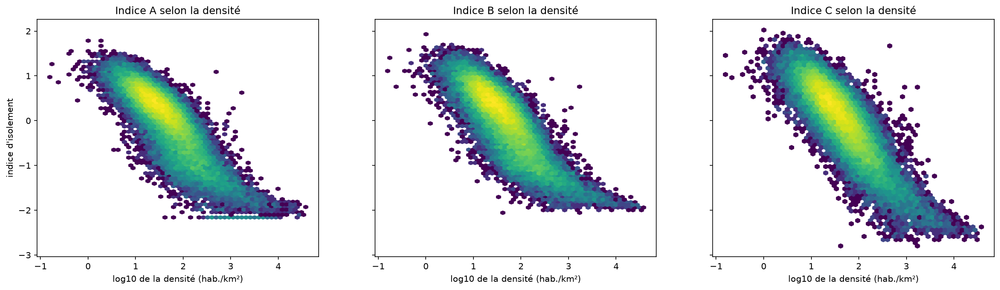

# Facteurs de l'isolement {#sec-facteurs}

Ce chapitre étudie les deux hypothèses sur les facteurs de l'isolement : le lien avec la densité de population (H2) et le lien avec le revenu (H3). Nous menons chaque analyse avec les trois indices, pour voir si la réponse dépend de la méthode.

## Isolement et densité {#sec-densite}

Nous mesurons le lien avec la corrélation de Spearman, qui compare des classements plutôt que des valeurs : la densité est si asymétrique (de 0 à plus de 38 000 habitants par km²) qu'une corrélation de Pearson serait dominée par quelques villes. Nous rangeons aussi les communes en cinq classes de densité de même effectif (quintiles) et nous comparons l'indice entre classes avec le test de Kruskal-Wallis et sa taille d'effet $\varepsilon^2$. Avec 35 000 communes, toutes les p-values sont minuscules : c'est la taille de l'effet qui compte.

| Indice | ρ de Spearman | ε² de Kruskal-Wallis | Communes |
|---|---|---|---|
| A | −0,843 | 0,680 | 34 788 |
| B | −0,826 | 0,654 | 34 788 |
| C | −0,840 | 0,678 | 34 788 |

: Lien entre l'indice et la densité {#tbl-densite}

| Indice | 1 (moins denses) | 2 | 3 | 4 | 5 (plus denses) |
|---|---|---|---|---|---|
| A | 0,72 | 0,43 | 0,19 | −0,16 | −0,98 |
| B | 0,75 | 0,44 | 0,16 | −0,20 | −0,98 |
| C | 0,81 | 0,45 | 0,15 | −0,24 | −1,02 |

: Indice médian par quintile de densité {#tbl-densite-quintiles}

{#fig-densite}

H2 est confirmée, avec les trois méthodes. Le lien entre densité et isolement est très fort : ρ = −0,84 avec A, −0,83 avec B et −0,84 avec C. La taille d'effet du test de Kruskal-Wallis est très élevée ($\varepsilon^2$ entre 0,65 et 0,68) : la classe de densité explique à elle seule environ deux tiers de la variation des rangs de l'indice. L'indice médian baisse régulièrement des communes les moins denses aux plus denses, avec les trois méthodes (@tbl-densite-quintiles, @fig-densite). L'écart est un peu plus grand avec C (de 0,81 à −1,02), qui sépare plus nettement les extrêmes.

C'est une corrélation, pas une preuve de causalité, mais le mécanisme est connu : un service s'installe là où il y a assez d'habitants pour le faire vivre.

## Isolement et revenu {#sec-revenu}

### Les communes sans revenu publié

Nous ajoutons le niveau de vie médian de chaque commune (Filosofi 2023, indicateur `MED_SL`). Pour les petites communes, l'INSEE ne publie pas le revenu (secret statistique) : ces communes restent dans la base avec une case vide. Le revenu est publié pour 30 812 communes ; son niveau de vie médian est de 25 780 € en médiane et de 26 270 € en moyenne (écart-type de 3 541 €, de 12 420 € à 62 730 €).

Les 3 976 communes sans revenu (11,4 %) sont nettement plus isolées que les autres, quelle que soit la méthode (@tbl-sans-revenu). Elles ne regroupent pourtant que 0,44 % de la population : ce sont les plus petites communes, couvertes par le secret statistique. L'analyse du revenu porte donc sur un ensemble de communes moins isolé que l'ensemble, et ne dit rien des communes les plus isolées.

| Indice | Avec revenu | Sans revenu |
|---|---|---|
| A | 0,07 | 0,72 |
| B | 0,02 | 0,76 |
| C | 0,02 | 0,79 |

: Indice médian selon que le revenu est publié ou non {#tbl-sans-revenu}

### Le lien entre l'indice et le revenu

Nous mesurons ensuite le lien entre l'indice et le revenu, puis nous vérifions qu'il ne s'agit pas d'un simple effet de la densité. La densité est liée à l'isolement (section précédente) et au revenu (ρ = 0,35) : elle peut créer un lien apparent entre les deux, c'est ce qu'on appelle un facteur de confusion. Nous refaisons donc la corrélation à l'intérieur de chaque classe de densité, où la densité varie peu.

| Indice | ρ de Spearman | ε² de Kruskal-Wallis | Communes |
|---|---|---|---|
| A | −0,216 | 0,050 | 30 812 |
| B | −0,210 | 0,048 | 30 812 |
| C | −0,306 | 0,095 | 30 812 |

: Lien entre l'indice et le revenu {#tbl-revenu}

| Indice | 1 (plus modestes) | 2 | 3 | 4 | 5 (plus aisées) |
|---|---|---|---|---|---|
| A | 0,28 | 0,20 | 0,13 | 0,01 | −0,23 |
| B | 0,25 | 0,18 | 0,10 | −0,03 | −0,29 |
| C | 0,34 | 0,21 | 0,08 | −0,10 | −0,40 |

: Indice médian par quintile de revenu {#tbl-revenu-quintiles}

| Indice | 1 (moins denses) | 2 | 3 | 4 | 5 (plus denses) |
|---|---|---|---|---|---|
| A | −0,071 | 0,006 | 0,052 | 0,153 | 0,294 |
| B | −0,060 | 0,013 | 0,053 | 0,145 | 0,280 |
| C | −0,153 | −0,116 | −0,113 | −0,043 | 0,165 |

: Corrélation de Spearman entre l'indice et le revenu, dans chaque classe de densité {#tbl-revenu-intra}

**Avec A et B, H3 n'est que partiellement confirmée.** Globalement, les communes plus modestes sont un peu plus isolées (ρ = −0,22 et −0,21), mais l'effet est faible ($\varepsilon^2$ ≈ 0,05). Il vient surtout de la densité, liée à la fois au revenu et à l'isolement. À densité comparable, le lien disparaît (ρ proche de 0 dans les classes peu denses) puis devient positif dans les communes les plus denses (+0,28 à +0,29) : en ville, les communes aisées sont un peu plus loin des services, comme les couronnes résidentielles.

**Avec C, le lien est nettement plus fort et résiste en partie à la densité.** Globalement, ρ = −0,31 et $\varepsilon^2$ = 0,095, soit deux fois plus qu'avec A et B. L'indice médian passe de 0,34 dans le quintile le plus modeste à −0,40 dans le plus aisé. À densité comparable, ρ reste négatif dans les quatre premières classes (−0,15, −0,12, −0,11, −0,04). Il n'est positif que dans les communes les plus denses (+0,17).

C donne plus de poids à la gare et à l'hôpital. Le résultat suggère que c'est surtout l'éloignement de ces équipements rares, plus que celui des commerces ou des médecins, qui va de pair avec un revenu plus faible, même entre communes de densité semblable. Une explication possible, que nous n'avons pas vérifiée : les actifs plus aisés s'installent près des gares et des villes moyennes, où se concentrent aussi les emplois qualifiés.

Le diagnostic sur le revenu dépend donc de la méthode : faible et dû à la densité si l'on compte 19 services, plus marqué si l'on donne autant de poids à chaque grand besoin.
