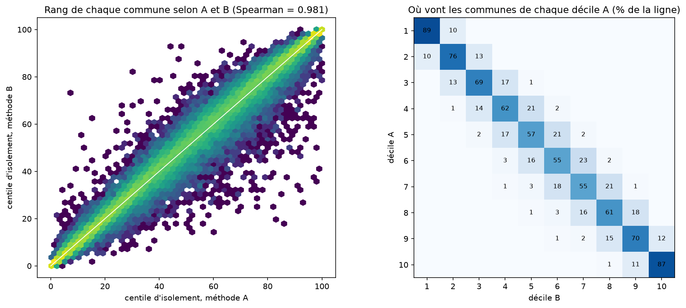
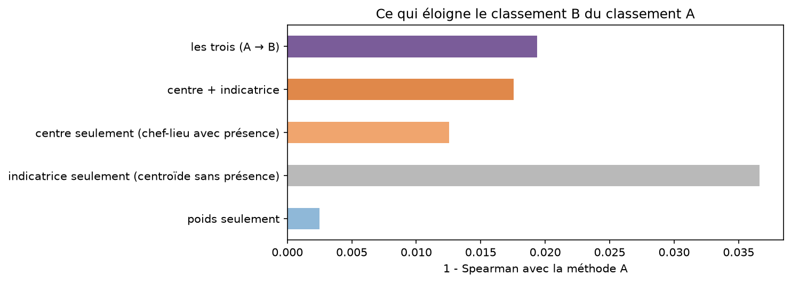

# Comparaison des méthodes {#sec-comparaison}

Les chapitres précédents donnent trois images de l'isolement. Ce chapitre cherche à savoir à quel point elles diffèrent, pour quelles communes, et lequel des choix (point de départ, indicatrice, poids, agrégation) est responsable des différences. Nous comparons d'abord A et B, qui diffèrent par le point de départ, l'indicatrice et les poids, puis nous situons C. C'est l'objet de l'hypothèse H4.

## A et B : les classements se ressemblent-ils ? {#sec-ressemblance}

La corrélation de Spearman entre A et B mesure la ressemblance des classements. Nous regardons aussi le tableau croisé des déciles : la part des communes qui restent dans le même dixième de la distribution, ou qui ne bougent que d'un décile.

{#fig-comparaison-rangs}

Les deux classements sont très proches : la corrélation de Spearman est de 0,981. Dans le tableau croisé des déciles (@fig-comparaison-rangs), 68,3 % des communes restent dans le même décile, 97,1 % bougent d'au plus un décile, et 0,6 % (environ 200 communes) bougent de trois déciles ou plus.

Le nuage de points montre que les écarts ne sont pas répartis au hasard. Ils sont plus forts au milieu de la distribution qu'aux extrémités. Les communes très bien desservies (les villes, qui ont presque tout sur place) et les communes très isolées gardent leur place. Au milieu, de petites différences de distance suffisent à faire bouger le rang.

## Le point de départ, l'indicatrice ou les poids ? {#sec-decomposition}

A et B diffèrent sur trois choix à la fois. Pour séparer leurs effets, nous calculons les $2 \times 2 \times 2 = 8$ indices qui combinent le point de départ $x$ (centroïde ou chef-lieu), la règle $r$ (avec indicatrice de présence ou sans) et les poids $w$ (égaux ou experts). Nous notons $I_c^{(x,\,r,\,w)}$ l'indice correspondant, de sorte que $A = I^{(x^A,\,r^A,\,w^A)}$ et $B = I^{(x^B,\,r^B,\,w^B)}$. L'écart de classement entre deux indices est mesuré par $1 - \rho_S$, où $\rho_S$ est la corrélation de Spearman (0 si le classement est identique). En partant de A et en ne changeant qu'un ingrédient à la fois, nous voyons lequel déplace le plus le classement.

| Point de départ | Règle | Poids égaux | Poids experts |
|---|---|---|---|
| centroïde | présence | 1,000 | 0,998 |
| centroïde | sans présence | 0,963 | 0,963 |
| chef-lieu | présence | 0,987 | 0,985 |
| chef-lieu | sans présence | 0,982 | 0,981 |

: Corrélation de Spearman de chacun des huit indices avec A {#tbl-huit}

| Changement par rapport à A | 1 − ρ avec A |
|---|---|
| poids seulement | 0,0025 |
| indicatrice seulement (centroïde sans présence) | 0,0366 |
| point de départ seulement (chef-lieu avec présence) | 0,0125 |
| point de départ et indicatrice | 0,0176 |
| les trois (A vers B) | 0,0194 |

: Ce qui éloigne le classement de A {#tbl-effets}

{#fig-decomposition}

Pris isolément, enlever l'indicatrice depuis le centroïde est le changement le plus perturbateur, mais il ne l'est plus depuis le chef-lieu (@tbl-effets). En partant de A et en ne changeant qu'un ingrédient :

- changer les poids : 0,0025, le classement ne bouge presque pas ;
- changer le point de départ : 0,0125, soit cinq fois plus que les poids ;
- enlever l'indicatrice depuis le centroïde : 0,0366, l'effet le plus fort.

Mais l'effet de l'indicatrice dépend du point de départ. L'enlever coûte 0,0366 depuis le centroïde, et seulement 0,0037 depuis le chef-lieu, soit dix fois moins. Depuis le centroïde, point arbitraire, la distance réelle à l'équipement de la commune est un artefact de la forme du territoire, d'où l'utilité de l'indicatrice. Depuis le chef-lieu, cette distance est faible et a un sens (chapitre [3](#sec-resultats-B)), si bien que l'indicatrice n'apporte presque rien. C'est ce qui justifie de l'enlever dans la méthode B.

Au total, A vers B donne 0,0194 (ρ = 0,981), dont l'essentiel vient du changement de point de départ. Les poids comptent peu pour deux raisons. La grille experte redistribue surtout le poids à l'intérieur des thèmes. Et les 19 distances varient ensemble (la première composante de l'ACP en résume 51 %) : toute pondération à poids positifs classe les communes dans un ordre voisin.

## Les communes les plus isolées sont-elles les mêmes ? {#sec-listes}

Pour l'action publique, ce qui compte souvent est la liste des communes les plus isolées, par exemple pour cibler une aide. Nous comparons les 10 % de communes les plus isolées selon A et selon B : combien sont communes aux deux listes, et combien d'habitants chacune représente.

Sur les 3 479 communes les plus isolées (10 %), 3 044 sont les mêmes avec A et B (87,5 % de recouvrement), et 435 changent. La population couverte est de 486 434 habitants avec A, de 491 710 avec B, et de 407 668 pour les communes présentes dans les deux listes.

| | 1 % | 5 % | 10 % | 25 % | 50 % |
|---|---|---|---|---|---|
| Communes présentes dans les deux listes (%) | 80,2 | 83,9 | 87,5 | 90,7 | 94,9 |

: Recouvrement des listes de communes les plus isolées selon A et B {#tbl-recouvrement}

Pour cibler les communes à aider, le choix de méthode compte donc un peu plus que ne le laisse penser la corrélation globale. Plus la liste est courte, plus le désaccord est grand : le recouvrement est de 84 % pour les 5 % les plus isolées et de 80 % pour le 1 % le plus isolé. Une politique qui viserait les 350 communes les plus isolées en désignerait environ 70 différentes selon la méthode. Ces listes couvrent un peu moins de 500 000 habitants.

## Quelles communes changent de rang, et pourquoi ? {#sec-mouvements}

Nous calculons pour chaque commune le changement de centile entre A et B (positif si la commune est plus isolée selon B). Nous regardons si les grands changements s'expliquent par l'écart entre centroïde et chef-lieu, par la surface ou par la population.

| Lien avec le changement de centile (en valeur absolue) | ρ de Spearman |
|---|---|
| écart centroïde et chef-lieu | 0,227 |
| surface | 0,040 |
| population | −0,102 |

: Ce qui accompagne les changements de rang entre A et B {#tbl-liens-mouvement}

| Écart entre les deux points | < 0,5 km | 0,5-1 km | 1-2 km | 2-5 km | > 5 km |
|---|---|---|---|---|---|
| Communes | 10 218 | 12 722 | 9 404 | 2 319 | 125 |
| Changement absolu médian (centiles) | 1,8 | 2,3 | 3,0 | 4,1 | 7,0 |
| Changement moyen signé (centiles) | 1,3 | 0,6 | −1,0 | −4,4 | −11,0 |

: Changement de centile selon l'écart entre le centroïde et le chef-lieu {#tbl-mouvement-ecart}

Les communes dont le centroïde est loin du chef-lieu deviennent moins isolées avec B. Quand l'écart entre les deux points dépasse 5 km, le centile baisse de 11 points en moyenne (−4,4 entre 2 et 5 km). Quand l'écart est faible, il monte légèrement (+1,3 sous 0,5 km). Comme nous comparons des rangs, les communes qui reculent font mécaniquement monter les autres. L'ampleur du changement est d'abord liée à l'écart entre les deux points (Spearman de 0,23).

| Commune | Population | Centile A | Centile B | Changement |
|---|---|---|---|---|
| Prunelli-di-Fiumorbo | 3 880 | 7,5 | 72,8 | +65,3 |
| Pietrosella | 2 074 | 29,8 | 82,8 | +53,0 |
| Villemaury | 1 283 | 43,3 | 92,8 | +49,4 |
| Peri | 2 044 | 15,8 | 62,7 | +46,9 |
| Mansac | 1 554 | 10,5 | 56,0 | +45,4 |
| Castello-di-Rostino | 522 | 48,2 | 92,7 | +44,4 |
| Val-Cenis | 2 112 | 37,4 | 78,3 | +40,9 |
| Calmont | 2 192 | 26,9 | 67,1 | +40,3 |
| Naussac-Fontanes | 372 | 86,9 | 17,8 | −69,1 |
| Le Malzieu-Forain | 484 | 93,1 | 25,8 | −67,2 |
| Belvédère | 601 | 82,3 | 19,8 | −62,5 |
| Ascou | 113 | 97,1 | 35,8 | −61,2 |
| Vielle-Aure | 315 | 92,2 | 32,1 | −60,1 |
| Louvie-Soubiron | 133 | 97,2 | 38,0 | −59,2 |
| Aston | 197 | 99,0 | 41,5 | −57,4 |
| Osse-en-Aspe | 330 | 82,3 | 25,8 | −56,5 |

: Les huit communes qui montent le plus et les huit qui baissent le plus entre A et B {#tbl-mouvements}

Les plus fortes baisses (−56 à −69 centiles) sont des communes de montagne dont le bourg est dans une vallée équipée et le centroïde en altitude : Vielle-Aure (Hautes-Pyrénées), Aston et Ascou (Ariège), Louvie-Soubiron et Osse-en-Aspe (Pyrénées-Atlantiques), Belvédère (Alpes-Maritimes). On y trouve aussi des communes de Lozère dont le chef-lieu touche un bourg équipé voisin : Naussac-Fontanes à côté de Langogne, Le Malzieu-Forain à côté du Malzieu-Ville. Selon A, elles faisaient partie des 20 % les plus isolées. Selon B, elles sont dans la moitié la moins isolée.

Les plus fortes hausses (+40 à +65 centiles) révèlent la limite de B : le chef-lieu n'est pas toujours là où vivent les habitants.

- En Corse, Prunelli-di-Fiumorbo, Pietrosella, Peri et Castello-di-Rostino ont gardé leur chef-lieu dans le village perché historique, alors que la population et les commerces sont descendus vers la plaine ou la côte (Migliacciaro pour Prunelli-di-Fiumorbo). Sans l'indicatrice, les services de la commune comptent pour leur distance réelle au chef-lieu, qui est grande.
- Les communes nouvelles, nées de la fusion de plusieurs communes, comme Val-Cenis (Savoie) ou Villemaury (Eure-et-Loir), n'ont qu'un chef-lieu, alors que leurs services sont répartis entre les anciens villages.

Ces communes de 500 à 3 900 habitants passent du milieu au haut du classement. Pour elles, A, qui met les services présents à 0, est sans doute plus juste que B.

## Une robustesse élargie : 30 indices {#sec-robustesse-resultats}

A et B ne sont que deux combinaisons parmi beaucoup d'autres possibles. Nous avons croisé deux points de départ, trois règles de distance et cinq jeux de poids (section [Tester la solidité de l'indice](#sec-robustesse)), ce qui donne 30 indices, comparés à A et à B.

| Point de départ | Règle | Égaux | Experts | Vitaux | Thèmes | ACP |
|---|---|---|---|---|---|---|
| centroïde | positions_AB | 0,996 | 0,995 | 0,991 | 0,976 | 0,996 |
| centroïde | présence | 1,000 | 0,998 | 0,996 | 0,979 | 0,999 |
| centroïde | sans présence | 0,963 | 0,963 | 0,960 | 0,940 | 0,964 |
| chef-lieu | positions_AB | 0,985 | 0,983 | 0,981 | 0,966 | 0,984 |
| chef-lieu | présence | 0,987 | 0,985 | 0,984 | 0,968 | 0,986 |
| chef-lieu | sans présence | 0,982 | 0,981 | 0,979 | 0,963 | 0,981 |

: Corrélation de Spearman de chacun des 30 indices avec la méthode A {#tbl-trente-A}

| Point de départ | Règle | Égaux | Experts | Vitaux | Thèmes | ACP |
|---|---|---|---|---|---|---|
| centroïde | positions_AB | 0,976 | 0,978 | 0,972 | 0,957 | 0,977 |
| centroïde | présence | 0,981 | 0,982 | 0,977 | 0,960 | 0,981 |
| centroïde | sans présence | 0,945 | 0,948 | 0,942 | 0,922 | 0,947 |
| chef-lieu | positions_AB | 0,991 | 0,992 | 0,987 | 0,971 | 0,991 |
| chef-lieu | présence | 0,995 | 0,996 | 0,992 | 0,974 | 0,995 |
| chef-lieu | sans présence | 0,998 | 1,000 | 0,993 | 0,977 | 0,998 |

: Corrélation de Spearman de chacun des 30 indices avec la méthode B {#tbl-trente-B}

Les 30 indices restent tous très corrélés : la plus faible corrélation entre deux d'entre eux est de 0,92, au-dessus du seuil usuel de 0,9 pour des classements très proches. Quatre enseignements se dégagent.

1. Les jeux de poids comptent peu, sauf le jeu « thèmes », qui donne à la gare seule le poids de tout un thème (20 %). C'est le jeu le plus éloigné, avec 0,98 avec A et avec B sur la même ligne. Les poids de l'ACP sont presque des poids égaux (0,999 avec A) : la première composante explique 51 à 54 % de la variance dans les six configurations.
2. Avec le chef-lieu, garder ou enlever l'indicatrice ne change presque rien : 0,996 avec B pour la variante `presence`. Avec le centroïde, enlever l'indicatrice change nettement le classement : 0,963 avec A. La méthode B est donc peu sensible à ce choix, ce qui n'est pas le cas d'un indice construit sur le centroïde.
3. Les positions de moindre qualité (`M` et `_U`) ne faussent pas le résultat : ne garder que les positions `A` et `B` donne 0,996 avec A (centroïde) et 0,992 avec B (chef-lieu).
4. Le point de départ reste le choix qui sépare le plus les familles d'indices : tous les indices calculés depuis le centroïde sont à 0,92 à 0,98 de B, tous ceux calculés depuis le chef-lieu à 0,97 à 1,00.

## Les conclusions changent-elles avec la méthode ? {#sec-conclusions-methode}

La question la plus importante est de savoir si nos conclusions sur la densité (H2) et le revenu (H3) tiennent quel que soit l'indice. Nous recalculons les deux corrélations pour les 30 indices.

| | Minimum | Médiane | Maximum | A | B | C |
|---|---|---|---|---|---|---|
| ρ avec la densité | −0,861 | −0,834 | −0,822 | −0,843 | −0,826 | −0,840 |
| ρ avec le revenu | −0,287 | −0,222 | −0,197 | −0,216 | −0,210 | −0,306 |

: Étendue des corrélations sur les 30 indices {#tbl-etendue}

Pour la densité, la conclusion ne dépend pas de la méthode. Sur les 30 variantes de A et B, la corrélation avec la densité reste comprise entre −0,82 et −0,86. C est dans cet intervalle (−0,84). Pour le revenu, elle dépend de l'agrégation. Sur les 30 variantes, la corrélation avec le revenu va de −0,20 à −0,29 : faible et négative partout. A (−0,22) et B (−0,21) sont dans cet intervalle. C en sort, à −0,31. Aucune variante de point de départ, d'indicatrice ou de poids par service ne donne un lien aussi fort que le regroupement en besoins.

## Et la méthode C ? {#sec-C-comparaison}

C reprend les distances de B et ne change que l'agrégation : six besoins à poids égaux au lieu de 19 services pondérés. Nous mesurons à quel point cela change le classement, quelles communes sont concernées, et pourquoi.

| | A | B | C |
|---|---|---|---|
| A | 1,000 | 0,981 | 0,946 |
| B | 0,981 | 1,000 | 0,954 |
| C | 0,946 | 0,954 | 1,000 |

: Corrélation de Spearman entre les trois indices {#tbl-spearman-ABC}

| Paire | 1 % les plus isolées | 10 % les plus isolées |
|---|---|---|
| A et B | 80,2 | 87,5 |
| B et C | 71,6 | 78,4 |
| A et C | 69,3 | 78,2 |

: Communes présentes dans les deux listes (%) {#tbl-recouvrement-ABC}

C est la méthode qui s'écarte le plus des deux autres. Sa corrélation de rangs est de 0,954 avec B et 0,946 avec A, contre 0,981 entre A et B. Le changement de centile médian entre B et C est de 4,8 points, deux fois plus qu'entre A et B (2,3). Les listes de communes les plus isolées divergent aussi davantage : seulement 78 % de recouvrement entre B et C sur les 10 % les plus isolées (contre 87,5 % entre A et B), et 72 % sur le 1 %. Changer l'agrégation pèse donc plus que changer le point de départ ou les poids service par service.

| Besoin | ρ avec le changement de centile de B à C |
|---|---|
| Se soigner au quotidien | −0,160 |
| Faire ses courses | −0,141 |
| Démarches et accompagnement social | −0,002 |
| Scolariser ses enfants | 0,204 |
| Soins hospitaliers | 0,375 |
| Se déplacer | 0,503 |

: Ce qui fait bouger les communes de B à C {#tbl-besoins-mouvement}

Ce qui fait bouger les communes, c'est le transport et l'hôpital. Le changement de centile entre B et C est d'abord lié à l'éloignement de la gare (ρ = 0,50), puis à celui de l'hôpital (0,38) et de l'école (0,20). Il est en revanche lié négativement aux soins courants (−0,16) et aux courses (−0,14). Les communes loin d'une gare ou d'un hôpital reculent avec C, celles qui manquent surtout de commerces ou de médecins avancent.

| Commune | Centile B | Centile C | Changement | Besoin le plus éloigné |
|---|---|---|---|---|
| L'Île-d'Yeu | 29,2 | 89,3 | +60,1 | démarches et accompagnement social |
| Bonifacio | 18,8 | 72,5 | +53,7 | se déplacer |
| Mézières-en-Brenne | 25,5 | 78,0 | +52,5 | scolariser ses enfants |
| Ouessant | 38,4 | 89,9 | +51,5 | scolariser ses enfants |
| Pontaumur | 20,7 | 72,0 | +51,3 | se déplacer |
| Val-d'Isère | 34,5 | 85,2 | +50,7 | démarches et accompagnement social |
| Saintes-Maries-de-la-Mer | 27,2 | 77,8 | +50,6 | scolariser ses enfants |
| Meyrueis | 20,0 | 70,3 | +50,2 | se déplacer |
| Ventenac | 89,0 | 59,2 | −29,9 | se soigner au quotidien |
| Baulou | 70,6 | 40,8 | −29,8 | démarches et accompagnement social |
| Loreux | 83,0 | 53,4 | −29,6 | faire ses courses |
| Sainte-Colombe | 62,0 | 32,6 | −29,5 | faire ses courses |
| Béard | 86,2 | 56,9 | −29,3 | se soigner au quotidien |
| Louroux-de-Bouble | 76,8 | 47,7 | −29,1 | soins hospitaliers |
| Houéville | 77,0 | 48,3 | −28,8 | se soigner au quotidien |
| Vierzy | 74,9 | 46,4 | −28,5 | faire ses courses |

: Les huit communes qui montent le plus et les huit qui baissent le plus entre B et C {#tbl-mouvements-BC}

Les plus fortes hausses (+50 à +60 centiles) sont des communes bien équipées sur place mais loin des grands réseaux : les îles (L'Île-d'Yeu, Ouessant), les bouts de territoire (Bonifacio, Saintes-Maries-de-la-Mer en Camargue, Val-d'Isère en fond de vallée) et de petits bourgs-centres ruraux (Mézières-en-Brenne, Pontaumur, Meyrueis). Avec 19 services, leurs commerces, médecins et écoles les classaient dans la moitié la mieux desservie. Avec six besoins, la distance à la gare, au lycée et à l'hôpital les fait passer dans le tiers le plus isolé. Pour une île ou un fond de vallée, c'est plutôt une correction juste.

Les plus fortes baisses (environ −30 centiles) sont de petits villages (Ventenac, Baulou, Loreux, Béard…) dont le plus grand retard porte sur les soins courants, les courses ou les démarches, c'est-à-dire des services de proximité. Ils sont probablement moins loin d'une gare ou d'un hôpital que la moyenne. C les juge moins isolés que B, car le manque de services de proximité y pèse moins.
