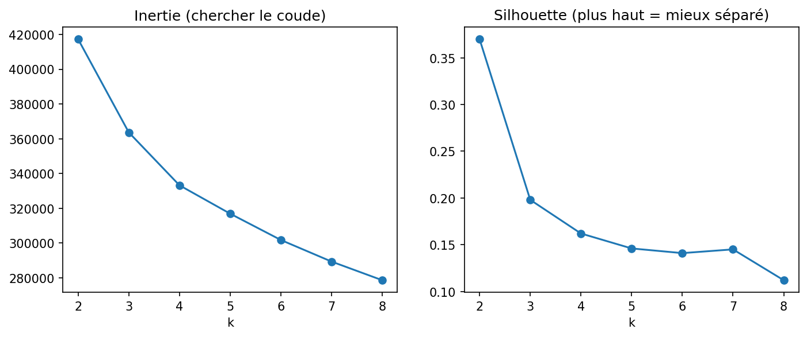
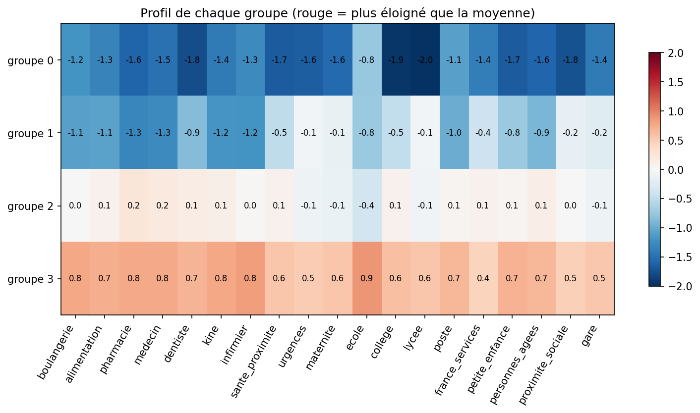
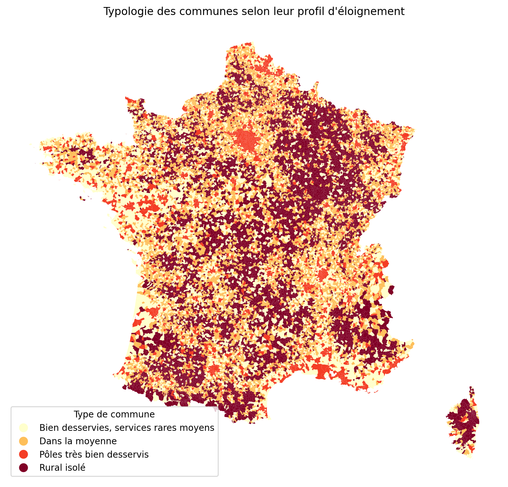
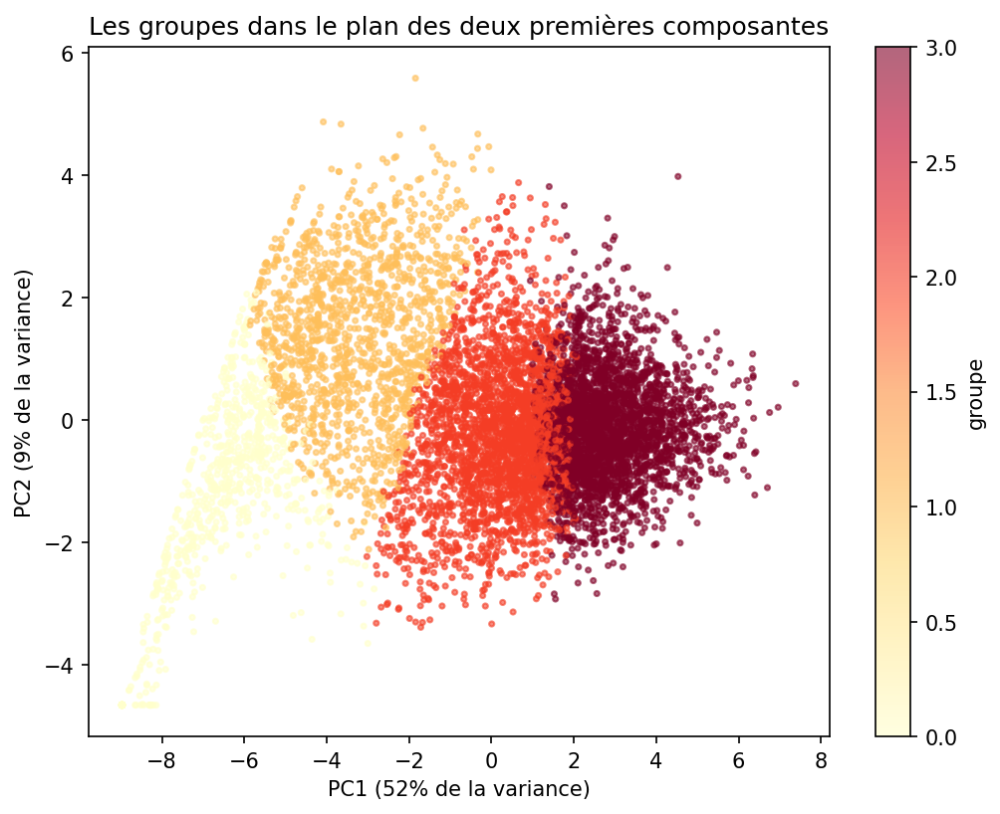

# Typologie des communes {#sec-typologie}

L'indice dit à quel point une commune est isolée, pas de quoi. Deux communes de même indice peuvent manquer de services très différents. Nous cherchons donc des profils types : des groupes de communes qui se ressemblent par la manière dont elles sont éloignées des 19 services.

## Méthode {#sec-methode-typologie}

Nous partons des 19 écarts standardisés $z$ de chaque commune (voir la section [L'indice d'isolement](01-donnees-methodologie.qmd#sec-indice)). L'algorithme des k-moyennes (k-means) forme $k$ groupes en répétant deux étapes : rattacher chaque commune au centre de groupe le plus proche, puis recalculer chaque centre comme la moyenne de son groupe. Il faut fixer $k$ à l'avance. Pour le choisir, nous regardons deux indicateurs.

- L'inertie, somme des carrés des écarts aux centres, baisse toujours quand $k$ augmente. Nous cherchons le « coude » où elle cesse de baisser vite.
- La silhouette, comprise entre −1 et 1, indique si les groupes sont bien séparés : plus elle est haute, mieux c'est.

Nous calculons ces deux indicateurs pour $k$ de 2 à 8, sur un échantillon de 5 000 communes pour limiter le temps de calcul (@tbl-choix-k et @fig-choix-k).

| $k$ | Inertie | Silhouette |
|--:|--:|--:|
| 2 | 417 308 | 0,370 |
| 3 | 363 681 | 0,198 |
| 4 | 333 254 | 0,162 |
| 5 | 316 938 | 0,146 |
| 6 | 301 811 | 0,141 |
| 7 | 289 396 | 0,145 |
| 8 | 278 675 | 0,112 |

: Inertie et silhouette selon le nombre de groupes {#tbl-choix-k}

{#fig-choix-k fig-alt="Inertie et silhouette en fonction du nombre de groupes k" width="85%"}

L'inertie baisse sans coude net, et la silhouette est la plus haute pour $k = 2$ (0,37) puis baisse (0,16 pour $k = 4$, 0,14 pour $k = 6$). Les communes ne forment donc pas des groupes bien séparés : elles s'étalent plutôt sur un continuum, des villes aux communes rurales isolées. Avec $k = 2$, nous aurions seulement « urbain » contre « rural », ce qui est trop simple. Nous retenons $k = 4$, qui reste lisible, en gardant en tête que les frontières entre groupes sont en partie arbitraires. Le k-means est ensuite lancé sur les 34 788 communes, et les groupes sont numérotés du mieux desservi (0) au moins bien desservi (3).

## Les quatre profils {#sec-profils}

Le @tbl-groupes décrit les quatre groupes. La première composante principale explique 51,6 % de la variance des $z$ et la deuxième 9,3 % : la PC1 est la composante de l'ACP de l'indice, l'axe « proche ou loin de tous les services ».

| Groupe | Nom | Communes | Part de la population | Indice médian | Densité médiane (hab./km²) | Revenu médian (€) |
|--:|---|--:|--:|--:|--:|--:|
| 0 | Pôles très bien desservis | 3 030 | 63,7 % | −1,45 | 541,7 | 25 995 |
| 1 | Bien desservies, services rares moyens | 6 145 | 20,5 % | −0,72 | 112,9 | 25 980 |
| 2 | Dans la moyenne | 12 576 | 11,6 % | 0,07 | 50,9 | 26 390 |
| 3 | Rural isolé | 13 037 | 4,3 % | 0,62 | 15,8 | 24 910 |

: Les quatre groupes de la typologie {#tbl-groupes}

Le tableau montre un gradient très net, avec des groupes de tailles très inégales. Le groupe 0 ne représente que 9 % des communes mais près de 64 % des habitants. À l'opposé, le groupe 3 compte plus du tiers des communes (37 %) mais seulement 4,3 % de la population. Le revenu médian est presque le même dans les groupes 0, 1 et 2 (entre 25 980 € et 26 390 €) et un peu plus bas dans le groupe 3 (24 910 €), ce qui rejoint le lien faible entre isolement et revenu du chapitre précédent. Les noms des groupes sont ceux que nous leur avons donnés d'après ce tableau et d'après leurs profils.

La @fig-profils montre le profil moyen de chaque groupe : pour chacun des 19 services, la moyenne des $z$ des communes du groupe.

{#fig-profils fig-alt="Carte de chaleur des écarts standardisés moyens de chaque groupe pour les 19 services" width="95%"}

- Le groupe 0 est mieux desservi que la moyenne pour tous les services, avec des écarts de −0,8 (école) à −2,0 (lycée), et de −1,9 pour le collège.
- Le groupe 1 est bien desservi pour les services du quotidien et de santé (de −0,8 à −1,3, sauf le dentiste à −0,9), mais ses écarts sont proches de 0 pour les urgences, la maternité, le lycée, la proximité sociale et la gare (de −0,1 à −0,2). Ce sont des communes bien équipées en services courants, mais pas plus proches que la moyenne des services rares.
- Le groupe 2 est proche de la moyenne partout (écarts entre −0,1 et 0,2), sauf pour l'école (−0,4).
- Le groupe 3 est plus éloigné que la moyenne de tous les services, avec des écarts de 0,4 à 0,9, le plus élevé pour l'école (0,9).

## Cartes et plan factoriel {#sec-cartes-typologie}

La @fig-carte-typologie montre comment les groupes se répartissent sur le territoire.

{#fig-carte-typologie fig-alt="Carte de France des communes colorées selon leur groupe de la typologie" width="90%"}

Le groupe « Rural isolé » forme de grandes zones continues : un vaste ensemble de la Champagne à la Bourgogne et à la Lorraine, ainsi que les Alpes, les Pyrénées, la Corse, les Landes et une partie du Massif central. Les pôles très bien desservis apparaissent en îlots (la région parisienne forme un bloc très visible, ainsi que les grandes villes), et les communes bien desservies sont plus nombreuses sur la façade atlantique et dans le Nord-Ouest.

La @fig-acp place les communes sur le plan des deux premières composantes principales. Si les groupes s'ordonnent le long de la PC1, ils se distinguent surtout par leur niveau global d'éloignement, et moins par le type de service qui manque.

{#fig-acp fig-alt="Nuage de points des communes sur le plan PC1 par PC2, colorées par numéro de groupe" width="90%"}

Les groupes 0, 1, 2 et 3 se succèdent de gauche à droite le long de la PC1, avec un chevauchement entre groupes voisins. La typologie reflète donc d'abord un gradient d'éloignement global. La PC2 sépare surtout les communes du groupe 1 (en haut à gauche), proches des services courants mais pas des services rares, des autres. Cela rejoint les silhouettes faibles : il n'y a pas de frontières nettes entre les groupes, mais un continuum que nous découpons en quatre pour le décrire. Notons que cette figure colore les groupes par leur numéro, alors que la carte les colore par leur nom : les teintes ne sont donc pas les mêmes d'une figure à l'autre.
